<!-- https://bookdown.org/yihui/rmarkdown/xaringan-format.html -->
```{r, echo = FALSE, eval = FALSE}
#renderthis::to_pdf("Lecture05_CountingAnimals_PartII.Rmd")
```

```{r setup, include=FALSE}
knitr::opts_chunk$set(echo = FALSE, message = FALSE, cache = FALSE, 
                      warning = FALSE, las = 1, dpi = 100)
#output: html_document
```


```{r xaringan-scribble, echo=FALSE}
xaringanExtra::use_scribble()
```

```{r xaringan-tile-view, echo=FALSE}
xaringanExtra::use_tile_view()
```

```{r colsFunction, eval = FALSE}
system("cp images/raft3.jpg bg.jpg")
system("cp ../mycss.css ./")
xaringan::inf_mr()
```


```{r cache = FALSE}
#require(elieslides)
require(kableExtra)

pars <- function(...){
    par(mar = c(3,3,2,2), bty = "l", mgp = c(1.5,.25,0),
        tck = 0.01, cex.lab = 1.2, ...)
}
```


## Meet ... *Enhydra lutris*

.pull-left[

]

.pull-right[
- The largest ...
- The smallest ...
- The furriest ... 
  * guess how may hairs per in^2^? (*hint, humans are born with  ~100,000 TOTAL.*)
]

---


## Sea otters: Range

.pull-left-60[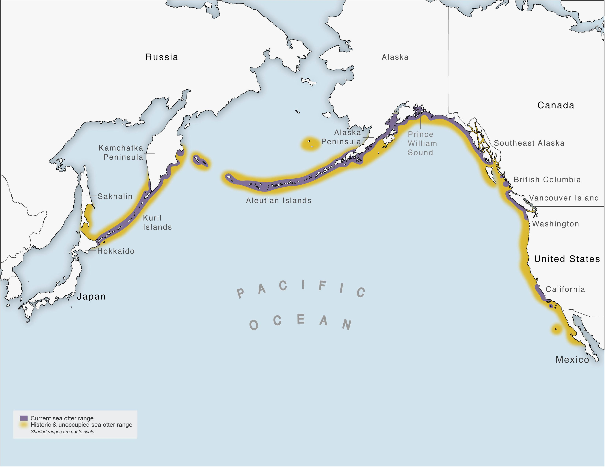]
.pull-right-40[*Littorally* the entire North Pacific]


---

## Sea otters: Keystone Species

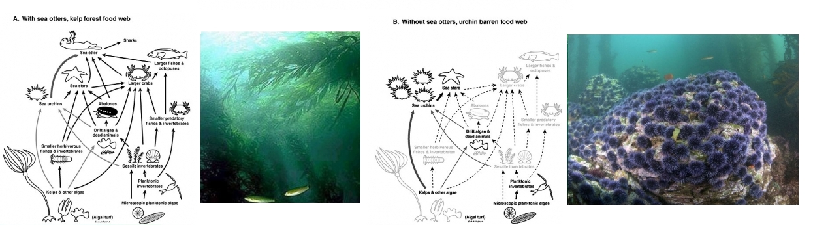

(Estes et al. 1974)

---

.pull-left-60[

## Sea otters: Furriness > Cuteness

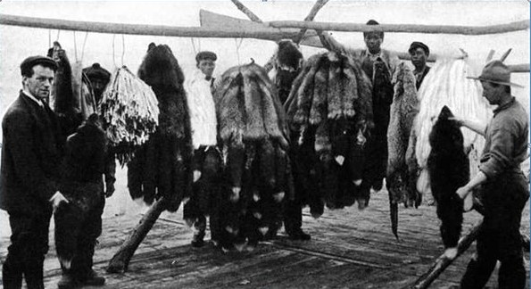
]


.pull-right-30[

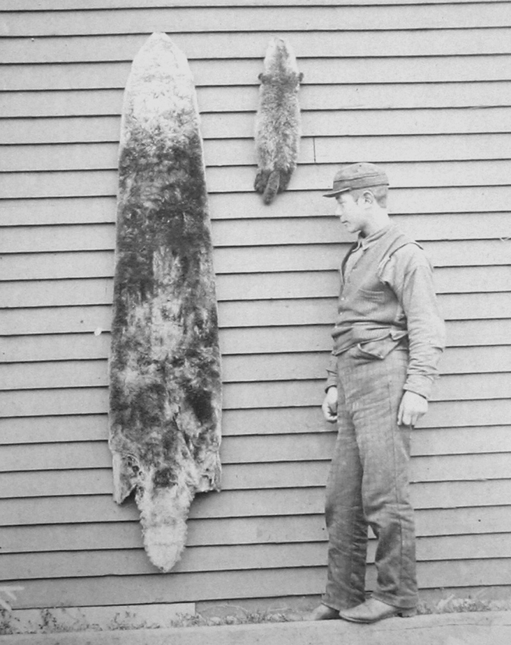
]
.pull-left[
- Fur trade (Russian -> British -> American) leads to near **extirpation** across the entire range.
- **> 300,000 in 1740 ... < 2,000 in 1900**.  
- Displacement and indenturing of Indigeneous fishermen (esp. Aleut)
]
.pull-right[
> .footnotesize[*... the rush for the otters’ “soft gold” was a predictable boom and bust ... a cautionary example of unsustainable resource use, and a socioeconomic driver of Western — mainly American — involvement in the Pacific region,*  (Loshbaugh 2021)]

]

---

## Sea otter reintroduction: Pacific NW

Remnant populations from Aleutian Islands ... released in OR, WA, BC and SE-AK  1969 – 1972. 

.pull-left[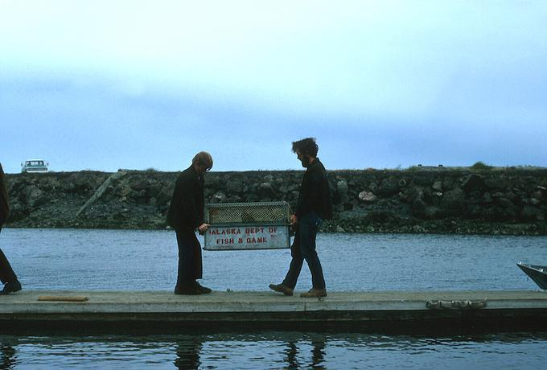]

.pull-right[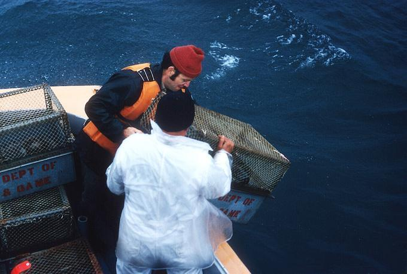]


---

## Sea otter reintroduction: Washington State ... 

.pull-left[]
.pull-right[
1970: 60 otters; 2010's: over 1000

```{r fig.width = 6, fig.height = 4, eval = FALSE}
WA <- read.csv("data/WA_SeaOtters_PopGrowth.csv")
require(ggplot2)
ggplot(WA, aes(year, count)) + geom_point()
```
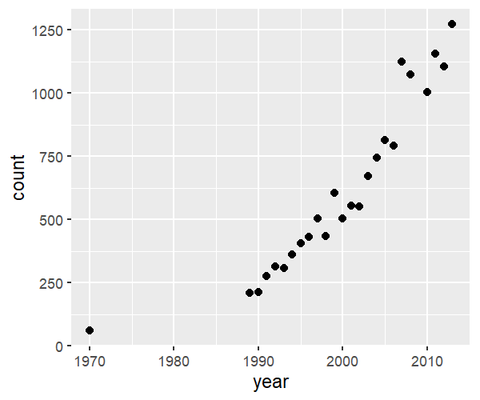
]

---

## Sea otter reintroduction: Washington State ... 

.pull-left[]
.pull-right[
1970: 60 otters;  2010's: over 1000

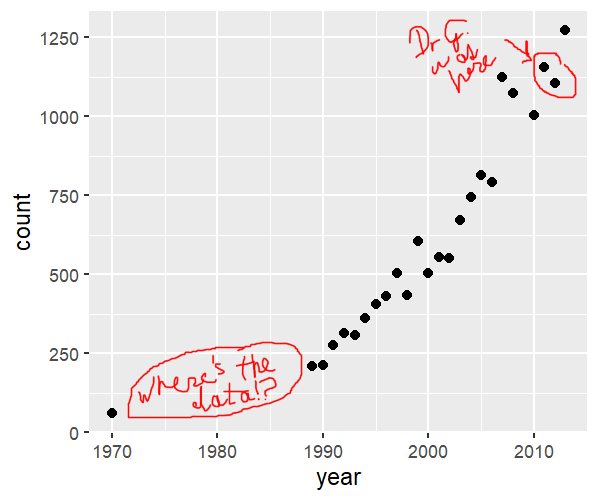
]


.center[***Success!***]


---

## Population ecology is all about ... 

 $$\huge N$$

 but where?  when? 

--

## Here! Now! ..

$$\huge N_t$$

 but how many were there? 

---

## That many, then $\Delta t$ ago!

$$\Large N_t = N_{t - \Delta t} + \Delta N$$

slight rearrangement:

$$\Large N_{t+1} = N_t + \Delta N$$

For now, $\Delta t = 1$, i.e. it's the discrete unit that we measure population change.  

VERY TYPICALLY:  

$$\Delta t = 1\,\, \textrm{year}$$. 

.darkred.large.center[Why!?]

---

## How does population change?


.pull-left-30[
### **B**irth
### **D**eath
### **I**mmigration
### **E**migration 
]
.pull-right-70[

$$\Large N_{t+1} = N_t + (B - D) + (I - E)$$
.center[This is the **Fundamental population equation**.]

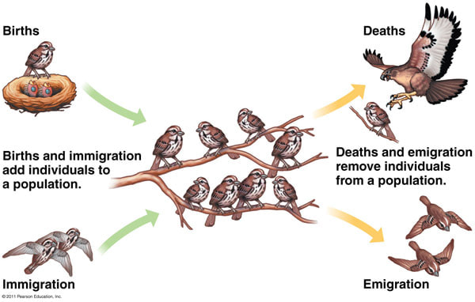
]

---
  
## Assumption 1: **Closed Population**

$$\Large N_{t+1} = N_t + B - D$$
.pull-left-30[
### **B**irth
### **D**eath

### .red[**I**mmigration]
### .red[**E**migration]
]

.pull-right-70[
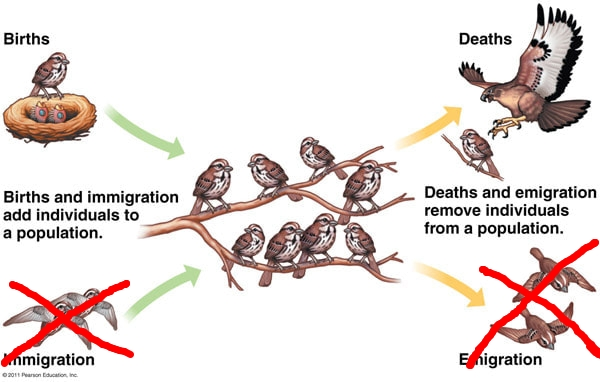

]


---
  
## Assumption 2: the important one

### The number of **Births** and **Deaths** is *proportional* to **N**.

$$\Large N_{t+1} = N_t + bN_t - dN_t$$
What does that mean?  What are the *units* on *b* and *d*? 

--

.pull-left.darkblue[
**Births**

- Every female gives birth to the same number of offspring? 

- Every female has the same *probability* of giving birth?  

- Every female has the same *probability* of giving birth to the same *distribution* of offspring? 
]

.pull-right.darkred[
**Deaths**

- A fixed proportion of all individuals dies? 

- Every individual has the same *probability* of dying? 

- the *distribution* of probabilities of dying is constant? 
]

---

## Some math ....


$$N_{t+1} = (1 + b - d) N_t$$

define $\lambda = 1 + b - d$. 


$$N_{t+1} = \lambda N_t$$


.large[
$\lambda$ is .blue[**rate of growth (or decrease)**]

- If $d > b$, $\lambda < 1$ ... Population FALLS
- If $b > d$, $\lambda > 1$ ... Population GROWS
]


---
 
## Cranking this forward

$$N_{t+1} = \lambda(N_t)$$
$$N_{t+2} = \lambda \times N_{t+1} = \lambda^2 N_t$$
$$N_{t+3} = \lambda^3 N_t$$
$$N_{t+4} = \lambda^4 N_t$$
In general:

$$\large N_{t+y} = \lambda^y N_t$$
or 

$$\huge N_t = \lambda^t N_0$$

.center[***Exponential*** growth.]

---

## Some examples

```{r LambdaExamples2, fig.width = 10, fig.height = 5}
pars(); par(mfrow = c(1,2), mar = c(3,3,3,2), las = 1)
lambdas <- c(1,1.1,1.15,1.2)
x <- 0:25
plot(x, x, ylim = c(0, 100), type = "n", xlab = "time", ylab = "count",
     main = expression(lambda >= 1))
cols <- c("darkgrey", "orange", "red", "darkred")
legend("topleft", col = cols, 
       pch = 19, legend = lambdas, bty, cex = 1.25)
for(i in 1:4) points(x, lambdas[i]^x, add = TRUE, 
                     col = cols[i], lwd = 2, pch = 19, type = "o")

lambdas <- c(1,0.95,0.9,0.8)
x <- 0:25
plot(x, x, ylim = c(0, 100), type = "n", xlab = "time", ylab = "count",
     main = expression(lambda <= 1))
cols <- c("darkgrey", "lightblue", "blue", "darkblue")
for(i in 1:4) points(x, 100*lambdas[i]^x, add = TRUE, 
                     col = cols[i], lwd = 2, pch = 19, type = "o")
legend("topright", col = cols, 
       pch = 19, legend = lambdas, cex = 1.25, bg = "white")
```


---

## How fast is exponential/geometric growth?

.pull-left-60[


Legend says the inventor of chess (in India) so delighted the raja, he was offered anything he wanted. 

Inventor said, not much.  One grain of rice on one square, 2 on the next, 4 on the next and so on till the board is filled. 
]
 
--

.pull-right-40[


Not only is there not enough rice in India to fill such a chessboard, **there are not enough atoms on earth**.  
]
---

## Note what the log-scale does

```{r LambdaExamples, fig.width = 10, fig.height = 4}

lambdas <- c(2,1.2,1.1,1,0.95,0.9,0.8)
cols <- c("darkred", "red", "orange", "darkgrey", 
          "lightblue", "blue", "darkblue")

pars(); par(mfrow = c(1,2), mar = c(3,3,3,2), las = 1)


N0 <- 10

x <- 0:25


x <- 0:25
plot(x, x, ylim = c(0, 200), type = "n", xlab = "time", ylab = "count", 
     main = "positive growth")
for(i in 1:length(lambdas)) points(x, N0*lambdas[i]^x, add = TRUE, 
                     col = cols[i], lwd = 2, pch = 19, type = "o")

legend("topright", col = cols, ncol = 2, 
       pch = 19, legend = lambdas, bty)

plot(x, x, ylim = c(1, 300), type = "n", xlab = "time", ylab = "count",
      log = "y", main = "log scale")

for(i in 1:length(lambdas)) points(x, N0*lambdas[i]^x, add = TRUE, 
                     col = cols[i], lwd = 2, pch = 19, type = "o")


```

It makes .large[VERY VERY LARGE] and .small[very very small] numbers all fit on the same scale!    (essentially asks: not *how many grains of rice* but *how many squares on the chessboard*)


---

# Note on $\lambda$ vs. $r$

There is also a *continuous time* version of the exponential growth equation that looks like this:

$$\huge{N(t) = N_0 e^{rt}}$$
where $r$ is the *instantaneous growth rate*.  The relationship is:
.center[
$\Large log(\lambda) = r\,\,\,$ or $\,\,\,\Large \lambda = e^r$ 
]

These are very similar but where:


.pull-left[
$\lambda$ is .blue[(*discrete*) growth rate]

- $\lambda < 1$ ... Population FALLS
- $\lambda > 1$ ... Population GROWS

More frequently used by **wildlife managers**.  
]

.pull-right-40[
$r$ is .darkred[(*instantaneous*) growth rate]

- $r < 0$ ... Population FALLS
- $r > 0$ ... Population GROWS

More frequently used by **population ecologists**.  
]


---

### One place you might have seen  $r$

.pull-left[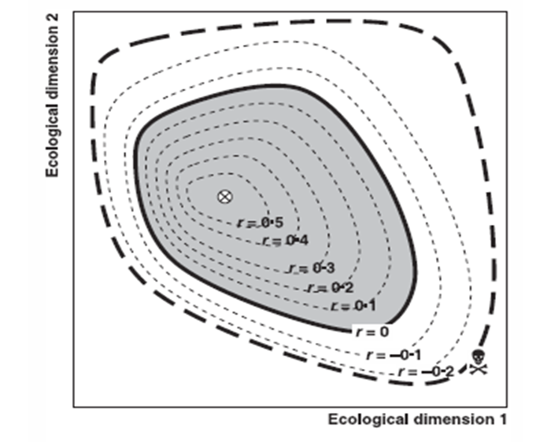
]

.pull-right[
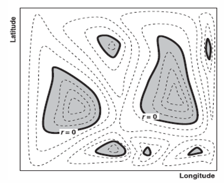
]

---

## Estimating some rates ... discrete

.pull-left-30[]

.pull-right-70[

The amazing thing is, if you have an equation "solved", you only need 2 points on the curve to compute. 

Let's use the discrete equation: 

$$N_{t+y} = \lambda^y N_t$$
$$1000 = 60 \times \lambda^{40}$$
$$16.7 = \lambda^{40}$$
$$2.81 = 40 \times \log (\lambda)$$
$$0.07025 = \log (\lambda)$$
$$\lambda = \exp(0.07025) = 1.0728$$

i.e. population increase about $$7.28\%/year$$. 
]
 

---

## Washington sea otter fit to data (7.025% discrete growth)

.pull-left-70[
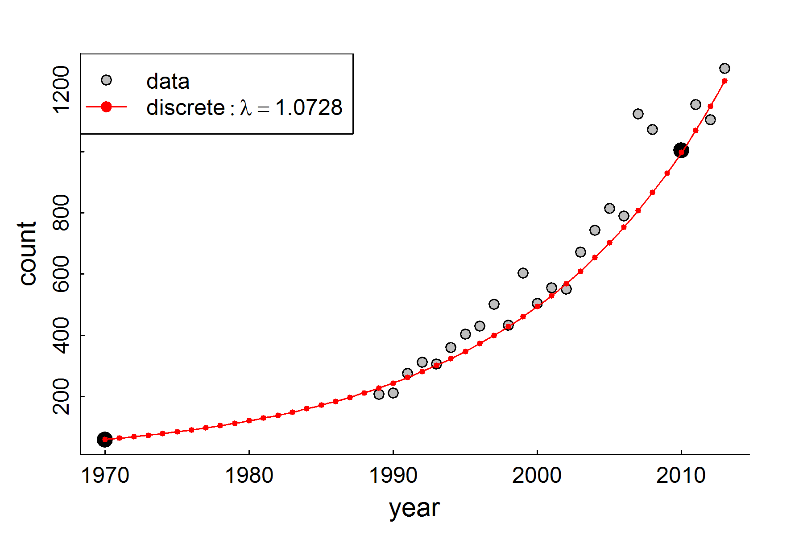
```{r, fig.width = 7, fig.height = 5, eval = FALSE}
#png("images/SeaOttersFitted.png", width = 1800, height = 1200, res = 300)
pars()
WA <- read.csv("data/WA_SeaOtters_PopGrowth.csv")
plot(WA, pch = 21, bg = "grey")
points(subset(WA, year %in% c(1970,2010)), pch = 19, cex = 1.5)
curve(60*exp( (x-1970) * 0.07025), add = TRUE, col = "red")
points(1970:2013, 60*1.0728^(0:43), cex = 0.5, pch = 19, col = "red")
legend("topleft", lty = c(NA,1), pch = c(21, 19), 
       legend = c("data", expression(discrete:lambda == 1.0728)), 
       col = c("black", "red", "red"), pt.bg = "grey")
#dev.off()
```
]

.pull-right-30[
### This is an EXCELLENT fit 


but why isn't it *perfect*?


.darkgreen[What are some potential sources of **variation**?]
]

---

## Estimating exponential growth rate from two points

.pull-left-50[
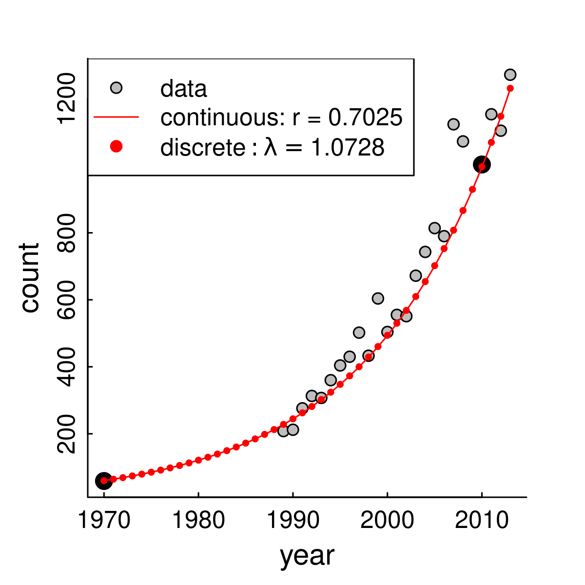

```{r, fig.width = 4, fig.height = 4, eval = FALSE}
png("images/SeaOttersFitted_vII.png", width = 1200, height = 1200, res = 300)
pars()
WA <- read.csv("data/WA_SeaOtters_PopGrowth.csv")
plot(WA, pch = 21, bg = "grey")
points(subset(WA, year %in% c(1970,2010)), pch = 19, cex = 1.5)
curve(60*exp( (x-1970) * 0.07025), add = TRUE, col = "red")
points(1970:2013, 60*1.0728^(0:43), cex = 0.5, pch = 19, col = "red")
legend("topleft", lty = c(NA,1,NA), pch = c(21, NA, 19), 
       legend = c("data", "continuous: r = 0.7025",
                  expression(discrete:lambda == 1.0728)), 
       col = c("black", "red", "red"), pt.bg = "grey")
dev.off()
```
]

.pull-right[

We fitted this with just two points:

year  | N
--|--
1970 | 60
2010 | 1000


.center[

... some math ... 

$\lambda = 1.0725$

7.25% annual growth
]

]


---

## But you could/should use ALL the data!

.pull-left[

**Using linear model of $\log(N)$ to estimate growth rate**

```{r, fig.height = 3, fig.width = 4, dpi = 200}
pars(); require(plyr)
WA <- read.csv("data/WA_SeaOtters_PopGrowth.csv")
WA.lm <- lm(log(count)~year, data = WA)

WA.predict <- predict(WA.lm, se = TRUE) %>% data.frame(WA) %>% 
    mutate(low = fit - 2*se.fit, high = fit + 2*se.fit)

n <- nrow(WA.predict)
with(WA.predict,
     {
        plot(year, log(count), pch = 21, bg = "grey")
        polygon(c(year, year[n:1]), c(low, high[n:1]), col = rgb(0,0,0,.4), bor = NA)
    })

curve(60*exp( (x-1970) * 0.07025), add = TRUE, col = "red")
points(1970:2013, 60*1.0728^(0:43), cex = 0.5, pch = 19, col = "red")
```

**Look how linear it's become!**
]

.pull-right[

Population Growth model:

$$\large N_t = N_0 \lambda^t$$

Log of both sides: 

$$\large \log(N_t) = \log(N_0) + \log(\lambda) \times t$$

This is a linear model!  

$$Y = \alpha + \beta X$$
where:  $\large \widehat{\beta} = \log(\widehat{\lambda})\,\,\,\,$ so $\,\,\,\large \hat{\lambda} = \exp\left(\widehat{\beta}\right)$]

]


---

## But you could/should use ALL the data!

.pull-left[

**Using linear model of $\log(N)$ to estimate growth rate**

```{r, fig.height = 3, fig.width = 4, dpi = 200}
pars()
WA.lm <- lm(log(count)~year, data = WA)

WA.predict <- predict(WA.lm, se = TRUE) %>% data.frame(WA) %>% 
    mutate(low = fit - 2*se.fit, high = fit + 2*se.fit)

n <- nrow(WA.predict)
with(WA.predict,
     {
        plot(year, log(count), pch = 21, bg = "grey")
        polygon(c(year, year[n:1]), c(low, high[n:1]), col = rgb(0,0,0,.4), bor = NA)
    })

curve(60*exp( (x-1970) * 0.07025), add = TRUE, col = "red")
points(1970:2013, 60*1.0728^(0:43), cex = 0.5, pch = 19, col = "red")
```

**Look how linear it's become!**
]

.pull-right[

```
lm(log(count)~year, data = WA_seaotters)
```

Model output:

.small[
```{r}
WA.lm <- lm(log(count)~year, data = WA)
summary(WA.lm)$coef %>% kable(digits = 4)
```
]

**Using ALL THE DATA, we get the benefit of a precision estimate as well:**


$$\widehat{\lambda} = \exp(\widehat{\beta});\,\,   \widehat{\lambda} = 1.076 \pm 0.005$$    

```{r, eval = FALSE}
summary(WA.lm)$coef %>% kable(digits = 4)
a <- summary(WA.lm)$coef %>% data.frame %>% mutate(lambda = exp(Estimate), low = exp(Estimate - 2*Std..Error), high = exp(Estimate + 2*Std..Error))
a <- a[2,]
```


.green.small[(actually, 95% confidence interval is not quite symmetric:

$$\small \exp(\widehat{\beta} - 2\sigma_{\beta}), \exp(\widehat{\beta} + 2\sigma_{\beta})$$

but close enough)]
]

---


.pull-left-60[
## Sources of variation?

```{r, fig.width = 4, fig.height = 4, eval = TRUE, dpi=100}
#png("images/SeaOttersFitted.png", width = 1800, height = 1200, res = 300)
pars()
WA <- read.csv("data/WA_SeaOtters_PopGrowth.csv")
plot(WA, pch = 21, bg = "grey")
points(subset(WA, year %in% c(1970,2010)), pch = 19, cex = 1.5)
curve(60*exp( (x-1970) * 0.07025), add = TRUE, col = "red")
points(1970:2013, 60*1.0728^(0:43), cex = 0.5, pch = 19, col = "red")
legend("topleft", lty = c(NA,1), pch = c(21, 19), 
       legend = c("data", 
                  expression(fit:lambda == 1.0728)), 
       col = c("black", "red"), pt.bg = "grey")
#dev.off()
```
]


### Observation error.
- How **precise**/**accurate** is the actual estimate? 


--

### Unexpected immigration / emigration.
- check assumptions about "closed population"

--

###  .red[**Environmental Stochasticity**]
Environment good / bad affecting **birth** and **death** for all animals.


---

.pull-left[
## Demographic Stochasticity

.darkred[**Stochasticity**] means: **randomness** in **time**.  

***Demography*** is the **Science of Population Dynamics**. Often it refers specifically to **births** and **deaths** (and **movements** ... but we're still looking at closed population). 

Individually, *all* demographic processes are stochastic.  An individual has some **probability** of dying at any moment.  An individual has some *probability* of reproducing (or some probability distribution of number of offspring) at a given time.

.green[**Question:**] How important is the randomness of *individual* events for a *population* process?  

.green[**More specific Q:**] What is the probability of extinction?
]
--

.pull-right[

## Human Experiment
.red[
> - 20 students
>
> - Flip a survival coin.  
>
>   - If you die (tails) sit down, if you live (heads) stay standing
>
> - Flip a reproduction coin.  
>   - If you reproduce (heads) call on another student to stand
]
]


---


## Cranking this experiment very many times. 

.pull-left[
https://egurarie.shinyapps.io/StochasticGrowth/

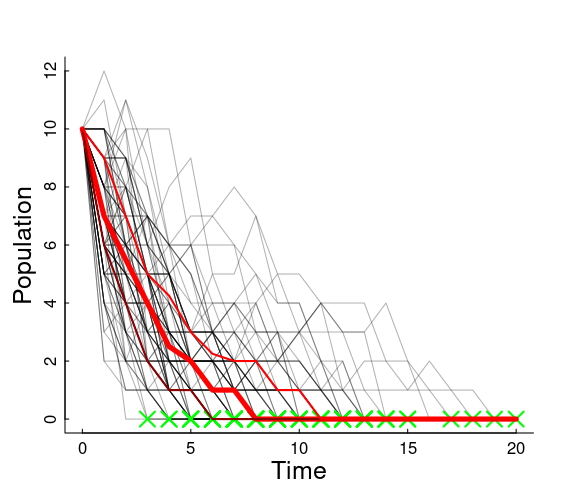
]

.pull-right[

On average, the number of individuals at time $t+1$ is the number that survived + the number that reproduced of those that survived.  

$$E(N_{t+1}) = p_s N_t + p_b\,p_s N_t = p_s (1+p_b) N_t$$

So (in our coin flip example) 
$$\widehat{\lambda} = p_s (1+p_b) = 0.75$$ 

**What does that mean for our population!?**


.center.large.red[Extinction is inevitable!]
]


---

## Even when population growth is 0... 


.pull-left-60[

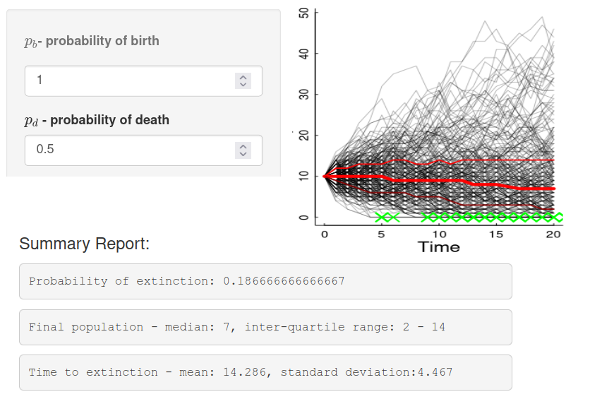
]

.pull-right-40[
Even if the population growth is 0 (neither growing nor falling) ....

$$\widehat{\lambda} = 0.5 \times (1+1) = 1$$   

**demographic stochasticity** leads to *some* probability of extinction always.


### Main take-away

**Demographic stochasticity** is important only for *small* populations.  

]


---

## Environmental Stochasticity...

.pull-left-40[

Some random aspect of the environment that influences .blue.large[***r***] (whether via .green[births] or .red[deaths] or **both**) for the **entire population**.:

$$R \sim Dist(\mu_r, \sigma_r)$$


- $\mu_r$ is the *mean growth rate*
- $\sigma_r$ is the *variability on the growth rate*
]

--

.pull-right-60[

> .darkred[**Can you think of some examples, e.g. for sea otters?**]


]


---

## Environmental Stochasticity

.pull-left-30[
- Affects entire population 

- Can ALSO increase risk of extinction

- or at least drive populations
]

.pull-right-70[
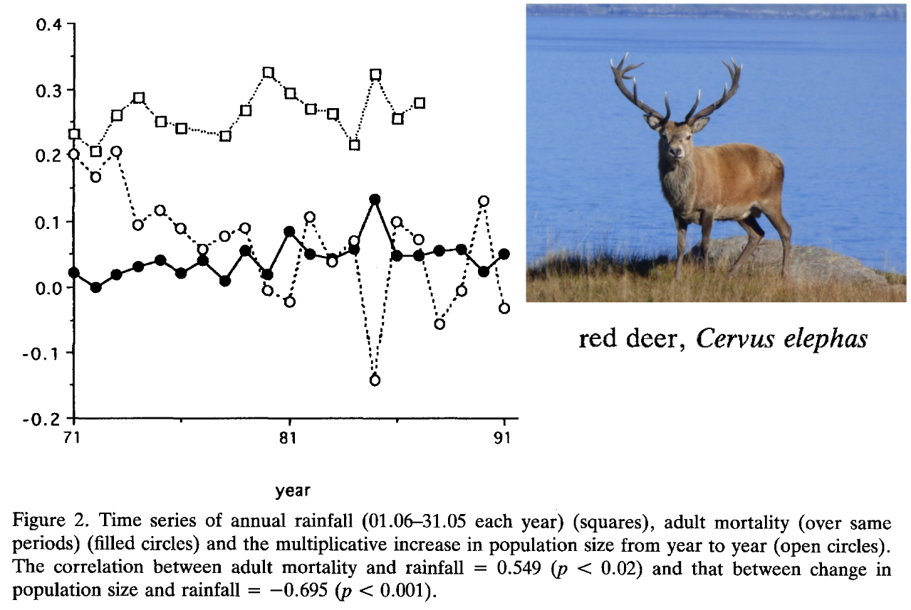

]


---

.large.pull-left-60[

## If things are TOO random that spells trouble!

According to theory, if: 

.darkred[$$\sigma_r > 2\mu_r$$]

extinction is nearly certain - even if $\mu_r$ is positive and on average there is growth.  

> .center[Experiment here: https://egurarie.shinyapps.io/StochasticGrowth] 

]


.pull-right-40[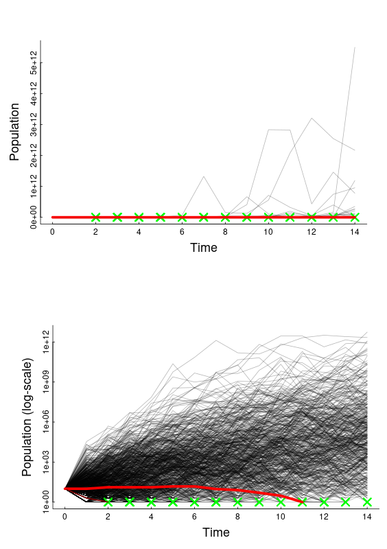
]


---

## Summary of Stochasticities


|  | .large[Demographic]  | .large[Environmental]  |
|---|---------------------------|----------------------------|
| **Acts on** | Individuals (randomly) | Entire population (simultaneously) |
| **Most important when** | Population is small | Any population size |
| **Example** | Which specific otter dies | Bad winter kills many otters |
| **Risk of extinction** | High for small populations | High when σ_r > 2μ_r |

.squeeze-30[

]

---

## some references

- Benton, T. G., A. Grant, and T. H. Clutton-Brock. 1995. Does environmental stochasticity matter? Analysis of red deer life-histories on Rum. Evolutionary Ecology 9:559–574.

- Estes, J. F. Palmisano. 1974. Sea otters: Their role in structuring nearshore communities. Science 185, 1058–1060. 

- Loshbaugh S. 2021. Sea Otters and the Maritime Fur Trade. In: Davis R.W., Pagano A.M. (eds) *Ethology and Behavioral Ecology of Sea Otters and Polar Bears. Ethology and Behavioral Ecology of Marine Mammals.*

- Gilkinson, A.K., Pearson, H.C., Weltz, F. and Davis, R.W., 2007. Photo‐identification of sea otters using nose scars. *The Journal of Wildlife Management*, 71(6), pp.2045-2051.

-  Veltre, D.W.  “Unangax̂: Coastal People of Far Southwestern Alaska”
