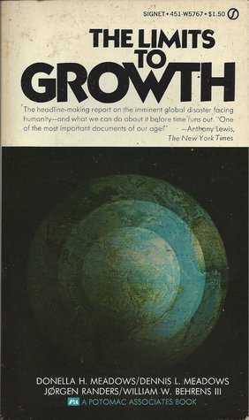
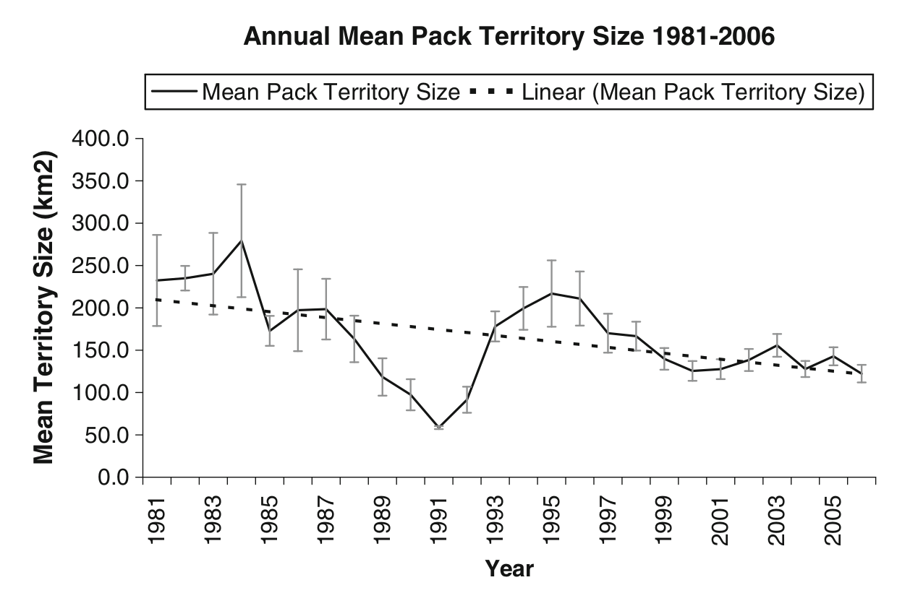
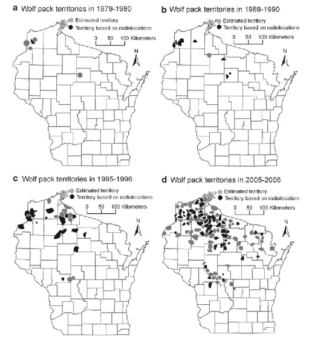
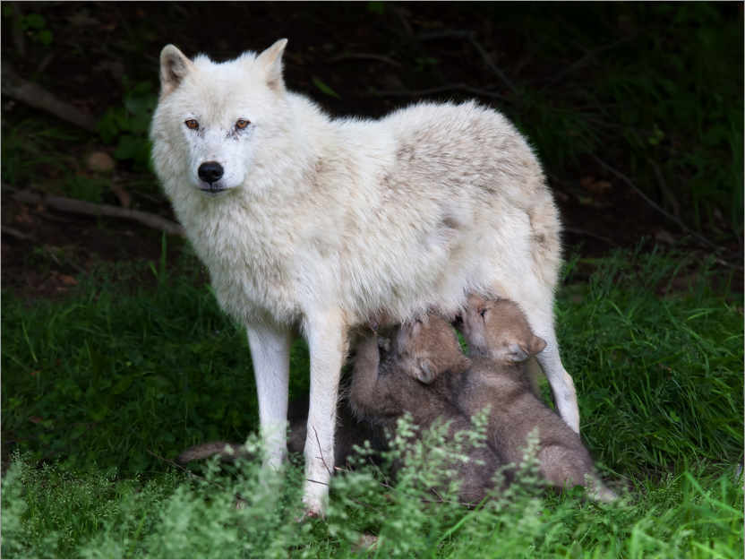
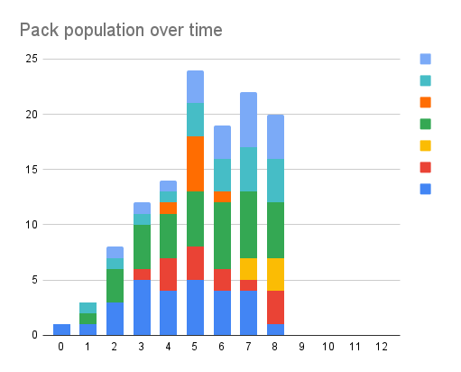
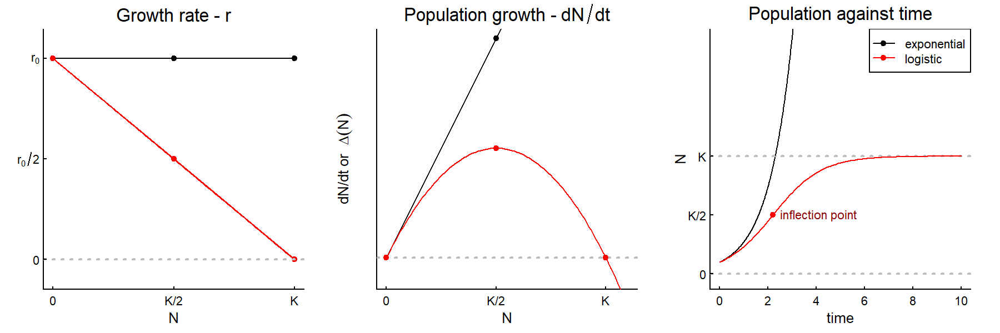
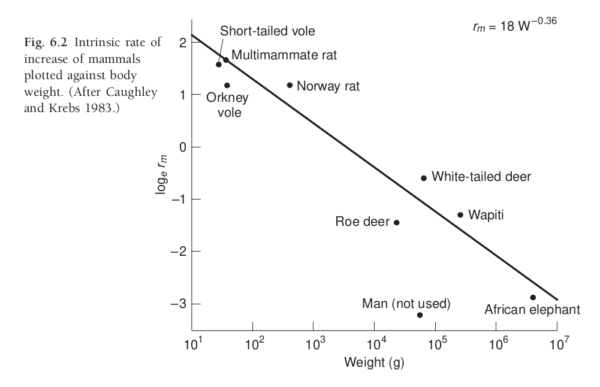
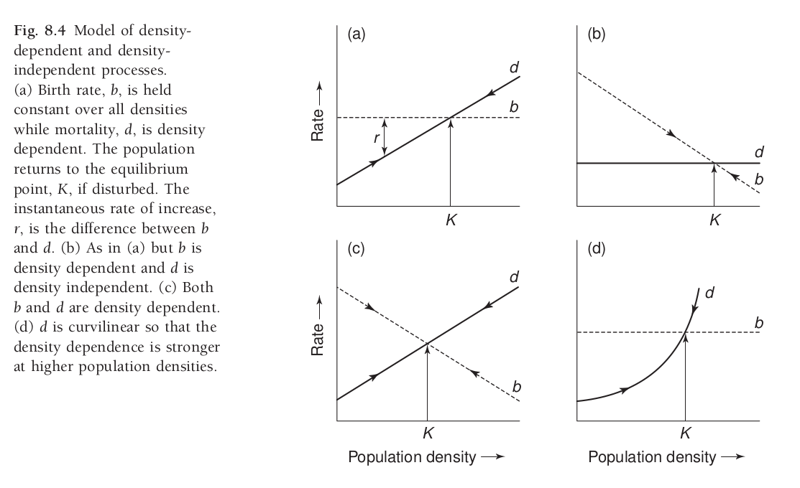
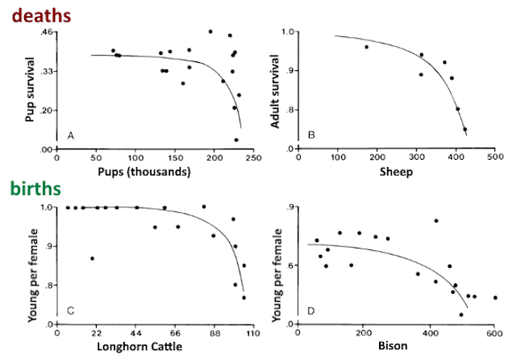
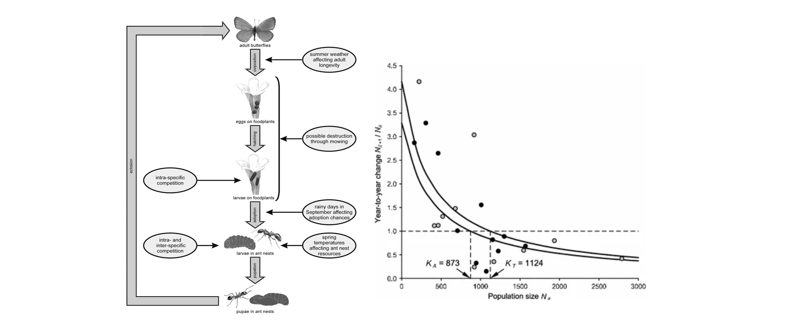

<!-- https://bookdown.org/yihui/rmarkdown/xaringan-format.html -->
```{r, echo = FALSE, eval = FALSE}
#renderthis::to_pdf("Lecture_PopulationEcology_PartII.Rmd")
```

```{r setup, include=FALSE}
knitr::opts_chunk$set(echo = FALSE, message = FALSE, cache = FALSE, 
                      warning = FALSE, las = 1, dpi = 200)
#output: html_document
```

```{r xaringan-scribble, echo=FALSE}
xaringanExtra::use_scribble()
```

```{r xaringan-tile-view, echo=FALSE}
xaringanExtra::use_tile_view()
```

```{r colsFunction, eval = FALSE}
system("cp images/raft3.jpg bg.jpg")
system("cp ../mycss.css ./")
xaringan::inf_mr()
```


```{r cache = FALSE}
#require(elieslides)
require(kableExtra)

pars <- function(...){
    par(mar = c(3,3,2,2), bty = "l", mgp = c(1.5,.25,0),
        tck = 0.01, cex.lab = 1.2, ...)
}
```


.pull-left-70[
---
## As populations grow ...

### they always hit **Limits to growth**

.content-box-blue.large[
- Space limits 

- Resource limitations

- Competition

- Predation

- Disease 

*All of these can interact *
]
]

.pull-right-30[

]

---

## Fundamental population equation

$$\huge \Delta N = B - D + I - E$$
.large[

Exponential growth assumes these (especially .red[**Birth**] & .red[**Death**]) are proportional to .red[**N**]. 

(in other words, *per capita* death *d* and birth *b* rates are constant)

But at high N ... B can fall, or D can rise, or I can decrease or E can increase.  

]

### Density dependence

.large[
Means that the *rate* of a parameter(e.g. $b = {B\over N}$ or $d = {D\over N}$ is: 
- (a) NOT constant
- (b) dependent on total population (or density) $N$.  
]


---

## Key demographic rates: **Fecundity** & **Survival**

.pull-left[

### Fecundity

**Number of offspring produced per individual** (usually per female)

.content-box-blue[
**Notation:**
- $b$ = fecundity rate
- $B = b \times N$ (total births)
- Often measured as:
  - offspring per female per year
  - litter size × litters per year
]

**Examples:**
- White-tailed deer: ~1.5 fawns/female/year
- Wolves: ~4 pups/female/year (in a pack)
- Mice: 5-10 pups/litter, multiple litters/year

]

.pull-right[

### Survival | Mortality

**Probability an individuals survives | dies**

.content-box-blue[
**Notation:**
- $s$ = survival rate (proportion surviving)
- $d = 1-s$ death rate
- $D = d \times N$ (total deaths)
]

**Examples:**

- Adult deer: $s \approx 0.85$ (85% survive/year)
  - equivalently: $d \approx 0.15$ (15% die/year)
- Juvenile survival often much lower
- Can vary by age, sex, season

]


---

.pull-left-50[
## Example: Wolf populations

-	Dispersal into new area, mainly wolf mating pairs. 
-	Highly territorial! 
-	Wolves produce up to 4 pups per litter that survive
-	If there are no neighbors, wolves will disperse to found new packs
-	Pack with 8 adults or 2 adults, still produces (about) 4 pups per litter 
-	If there are lots of neighbors, packs become larger (more individuals) in smaller territories. 



]


.pull-right-50[

**Expansion of Wisconsin Wolves, 1970's to 2000's**


]

---

##  Human-wolf experiment model 

.pull-left-60[

### basics of model
- 8 possible territories
- 1 initial dispersing wolf (female)

### each season ...
- One female / pack gives birth to 2 offspring
- Offspring can choose whether to disperse or not 
- 1/4 of all wolves die each year
]

.pull-right-40[

]

Enter data [here](https://docs.google.com/spreadsheets/d/15j2b3FCfbtrPkAlRb6QE6s55aRqggeSDi5YU6OBh7Yc/edit?usp=sharing)


---
class: inverse

##  Results of Human Wolf Experiment

.center[

Looks a lot like initial exponential growth stabilizes around 20 ind as die-offs balance out births. 
]


---

.pull-left[

# Modeling wolf population

Population equation: 

$$N_t = (1 + b - d) \times N_{t-1}$$


Death rate is constant: $d = 0.25$

Birth rate is high when population is low:
$b_0 = 2$

Birth rate is small when population is high:
- $N = 1$; $B = 2$; $b = 2$
- $N = 8$; $B = 16$; $b = 2$

But it hits an absolute maximum of 16 total.  So if:
- $N = 32$; $B = 16$; $b = 1/2$
- $N = 64$; $B = 16$; $b = 1/4$

]


.pull-right-40[

```{r WolfLogisticGrowth, fig.width = 4, fig.height = 6}
pars(); par(mfrow = c(2,1), las = 1)
plot(c(0,100),c(0,2), type = "n", ylab = "rate", xlab = "N", main = "Population growth rates")
abline(h = 0.25, col = "red", lwd = 2)
curve(ifelse(x<8,2,16/x), add = TRUE, col = "darkgreen", lwd = 2)
points(c(0,8,16,32,64), c(2,2,1,.5,.25), col = "darkgreen", pch = 19, cex = 0.8)
points(64, 1/4, pch = 19, col = "blue")
legend("topright", col = c("darkgreen", "red", "blue"),
       pch = c(NA, NA, 19), lwd = c(2,2,NA), bty = "n", 
       legend = c("birth", "death", "growth rate = 0"))

N <- 1
for(x in 1:25){
    b <- ifelse(N[length(N)]<8,2,16/N[length(N)])
    d <- .25
    N <- c(N, (1 + b - d)*N[length(N)])
}
plot(N, type = "o", pch = 21, bg = "grey", xlab = "year")
abline(h = 64, col = "orange", lwd = 2, lty = 2)
text(2, 64, "K = 64", pos = 3, xpd = NA, font = 2)
```

]


---


.pull-left-60[

##  Some Concepts

- Natural populations are always eventually limited 

- The "cap" on a population is called the .darkred[***Carrying Capacity*** ] (symbol: **K**).  This is 

- When population rates (*b*, *d*, also *i*, *e*) depend on the **total population**, this is called: .darkred[***Density Dependence***]. 

- The maximum growth rate (max $b-d$) is called the .darkred[**intrinsic growth rate**].  

]

.pull-right-40[

```{r WolfLogisticGrowth_II, fig.width = 4, fig.height = 6}
pars(); par(mfrow = c(2,1), las = 1)
plot(c(0,100),c(0,2), type = "n", ylab = "rate", xlab = "N", main = "Population growth rates")
abline(h = 0.25, col = "red", lwd = 2)
curve(ifelse(x<8,2,16/x), add = TRUE, col = "darkgreen", lwd = 2)
points(c(0,8,16,32,64), c(2,2,1,.5,.25), col = "darkgreen", pch = 19, cex = 0.8)
points(64, 1/4, pch = 19, col = "blue")
legend("topright", col = c("darkgreen", "red", "blue"),
       pch = c(NA, NA, 19), lwd = c(2,2,NA), bty = "n", 
       legend = c("birth", "death", "growth rate = 0"))

N <- 1
for(x in 1:25){
    b <- ifelse(N[length(N)]<8,2,16/N[length(N)])
    d <- .25
    N <- c(N, (1 + b - d)*N[length(N)])
}
plot(N, type = "o", pch = 21, bg = "grey", xlab = "year")
abline(h = 64, col = "orange", lwd = 2, lty = 2)
text(2, 64, "K = 64", pos = 3, xpd = NA, font = 2)
```

]


---

.pull-left[

# Logistic growth

.darkred[***Logistic growth***] is a specific kind of .darkred[Density Dependent] growth where the relationship between ***r*** and ***N*** is .darkred[**linear**]. The formula is:
$$r = r_0 (1 - N/K)$$

```{r fig.height = 3, fig.width = 6, out.width = "100%"}
pars(); par(mfrow = c(1,2), las = 1)
K <- 36
r <- 1
plot(c(0,K), rep(r,2), type = "o", pch = 19, 
     ylab = expression("Growth Rate ("~r~")"), 
     main = "Exponential growth", xlab = "N",
     ylim = c(-.3,1.1))

plot(c(0, K, 40), c(r, 0, r - 40/K), ylim = c(-.3,1.1),
     type = "o", pch = 19, 
     ylab = expression("Growth Rate ("~r~")"),
     main = "Logistic growth", xlab = "N")
abline(h = 0, lty = 3, lwd = 2, col = "grey")
abline(v = K, lty = 3, lwd = 2, col = "grey")
```

]

.pull-right[


```{r logisticcurves, fig.width = 5, fig.height = 4}
logisticfunction <- function(x, r, K, N0){
    K/(1 + ((K - N0)/N0)*exp(-r*x))
}
pars()

r <- 1
K <- 36
N0s <- c(0,1,5,20)
plot(0,0,type = "l", xlim = c(0,10), xlab = "time", ylab = "population", ylim = c(0,50), main = "logistic growth in time")
abline(h = K, lwd = 3, col = "grey")
palette(rainbow(length(N0s)))
for(i in 1:length(N0s))
    curve(logisticfunction(x, r, K, N0s[i]), col = i, add = TRUE, lwd = 2)
legend("right", col = 1:length(N0s), lwd = 3, legend = N0s, title = "N0", bty = "n")
```


- At $N=0$ - growth = 0
- At $N$ slightly above 0 - growth maximum $\approx r_0$
- At $N = K$ - growth = $0$
- At $N > K$ - growth < $0$
]

---

## Exponential vs. Logistic Growth in Three Graphs

.pull-left[
  ***Exponential*** | ***Growth***
  ---:|:---
  equation: | ${dN \over dt} = r N$
  solution: | $N(t) = N_0e^{rt}$
]

.pull-right[
  ***Logistic*** | ***Growth***
  ---:|:---
  equation: | ${dN \over dt} = r_0 N\left(1-{N\over K}\right)$
  solution: | $N(t) = {K \over 1 + \left({K-N_0 \over N_0}\right)e^{-r_0 t}}$
]

<br>


---


## Intrinsic growth rate:  $r_0$
.pull-left-40[
***In the best of all possible worlds***

.large[
$$\large r_0 = 1.5 \, W^{-0.36}$$
]

$W$ is live weight in kilograms
```{r intrinsic_examples, echo=FALSE}
# Function to calculate r0
require(plyr)
calc_r0 <- function(W) {
  1.5 * W^(-0.36)
}
weights <- c(mouse = 0.02,
             deer = 60,
             elephant = 4000)

examples <- data.frame(
  Species = c("Mouse", "White-tailed Deer", "Elephant"),
  weights) |> 
    mutate(r0 = calc_r0(weights) |> round(2),
           doubling_time = round(log(2)/r0, 1) |> round(2),
           weights = c("0.02", "60", "4000")
)

kable(examples, col.names = c("Species", "Weight (kg)", "r₀", "Doubling time (years)"),
      align = 'lrrr', row.names = FALSE) |>
  kable_styling(font_size = 16, bootstrap_options = c("striped"))
```

**Q. Why would this be the case?**

.large[Smaller animals: shorter generation times, larger litters, faster maturation]

]

.pull-right-60[




.small.center[[Caughley and Krebs (1983)](https://www.zoology.ubc.ca/~krebs/papers/58.pdf)
]


]


---

## Different models of density dependence

.pull-left-30[

**What is it that depends on density?**

Is it birth?  Is it death?  Is it linear?  Is it curvy? 

]

.pull-right-70[


.center[Fryxell chapter 8.]
]


---

# Density dependent mortality & fecundity

.pull-left-30[
## Convex curves

- **Mortality** can be high when densities are highest.

- **Fecundity** (# of offspring per female) falls at high densities. 

- For long-lived animals, this effect mainly kicks in at high numbers (*not linear*).  
]

.pull-right-70[


.center[Fowler (1981)]
]


---
.pull.left[
## **Concave curves:** Butterflies
]

.pull-right[When **density dependent effects** kick in when populations are **small** rather than **large**.]


.center[(Nowicki et al. 2009)]


---


## Carrying capacity 

.pull-left.large[
**Ecological carrying capacity**

Basically - *K* of a logistic growth

Limited (almost always) by: 

- resources: 
  - food
  - shelter
  - breeding **habitat**

- space

- interactions (predation / parasites / disease)
]

.pull-right[
> For the  **Howework assignment** you will explore different ways in which **Ecological Carrying Capacity** is estimated, and why it is an important question for wildlife ecologists to ask. 
]


---


.pull-left-60[
#### ***Kinds of "Carrying Capacity"***

### Ecological carrying capacity

**The natural limit** - **K** in logistic equation

- Set by **resources** in the environment
- Population equilibrium from density-dependence
  - lack of food, space, cover | predators | disease | etc.
- Can change as environment changes

### Economic carrying capacity

**Maximum sustained yield** - for harvest/cropping

- Population level for maximum offtake
- Used by range managers, animal production
- **Well below** ecological K
- For logistic growth: **K/2** or 50% of ecological K

]


.pull-right-40[
```{r economicK, fig.width = 6, fig.height = 8}
pars()
par(mfrow = c(2,1), mar = c(3,4,2,1))

# Top panel: Population growth rate
K <- 100
r0 <- 0.5
N <- seq(0, K*1.2, length.out = 200)
growth_rate <- r0 * N * (1 - N/K)

plot(N, growth_rate, type = "l", lwd = 3, col = "darkblue",
     xlab = "", ylab = "Population growth\n(dN/dt)", 
     main = "Logistic population growth rate",
     xlim = c(0, K*1.1), ylim = c(0, max(growth_rate)*1.1))
abline(v = K/2, col = "red", lwd = 2, lty = 2)
abline(v = K, col = "orange", lwd = 2, lty = 2)
abline(h = 0, col = "grey", lty = 1)
points(K/2, max(growth_rate), pch = 19, col = "red", cex = 1.5)
text(K/2, max(growth_rate), "Maximum\nSustained Yield", 
     pos = 3, col = "red", font = 2, cex = 0.9)
text(K, 0, "Ecological K", pos = 4, col = "orange", font = 2)
text(K/2, 0, "Economic K\n(K/2)", pos = 1, col = "red", font = 2, cex = 0.9)

# Bottom panel: Population over time
logistic <- function(t, N0, r, K) {
  K / (1 + ((K - N0)/N0) * exp(-r * t))
}

time <- seq(0, 20, length.out = 200)
N_t <- logistic(time, N0 = 5, r = r0, K = K)

plot(time, N_t, type = "l", lwd = 3, col = "darkblue",
     xlab = "Time", ylab = "Population size (N)",
     main = "Logistic population growth over time",
     ylim = c(0, K*1.1))
abline(h = K/2, col = "red", lwd = 2, lty = 2)
abline(h = K, col = "orange", lwd = 2, lty = 2)
text(2, K, "Ecological K", pos = 3, col = "orange", font = 2)
text(2, K/2, "Economic K (K/2)", pos = 3, col = "red", font = 2)
```
]

---

#### ***Kinds of "Carrying Capacity"***

.pull-left[

### Social / Cultural carrying capacity

**Human tolerance level** - varies by context

**Examples:**

Wolves on Wyoming ranch: **K = 0**  
-   *(no tolerance for livestock predation)*

Elephants near tourist hotels in Serengeti: 
- **K < ecological K**  to preserve scenic Acacia trees for tourism

Urban deer in residential areas: 
- **highly variable**  *(depends on garden/road collision damage tolerance)*
]


.pull-right[

.center[(Fryxell Chapter 8)]

]


---

## Some references

.small[
- Benton T G, A Grant, and T H Clutton-Brock. 1995. Does environmental stochasticity matter? Analysis of red deer life-histories on Rum. Evolutionary Ecology 9:559–574. [link](https://doi.org/10.1007/BF01237655)
- Caughley G and C J Krebs. 1983. Are Big Mammals Simply Little Mammals Writ Large? Oecologia 59:7-17. [link](https://doi.org/10.1007/BF00388065)
- Chapman E J and C J Byron. 2018. The flexible application of carrying capacity in ecology. Global Ecology and Conservation 13:e00365. [link](https://doi.org/10.1016/j.gecco.2017.e00365)
- Fowler C W. 1981. Density Dependence as Related to Life History Strategy. Ecology 62:602–610. [link](https://doi.org/10.2307/1937727)
- Laidre K L, R J Jameson, S J Jeffries, R C Hobbs, C E Bowlby, and G R VanBlaricom. 2002. Estimates of carrying capacity for sea otters in Washington state. Wildlife Society Bulletin 30:1172–1181. [link](https://www.jstor.org/stable/3784286)
- McClelland C J R, C K Denny, T A Larsen, G B Stenhouse, and S E Nielsen. 2021. Landscape estimates of carrying capacity for grizzly bears using nutritional energy supply for management and conservation planning. Journal for Nature Conservation 62:126018. [link](https://doi.org/10.1016/j.jnc.2021.126018)
- Nowicki P, S Bonelli, F Barbero, and E Balletto. 2009. Relative importance of density-dependent regulation and environmental stochasticity for butterfly population dynamics. Oecologia 161:227–239. [link](https://doi.org/10.1007/s00442-009-1373-2)
- Potvin F and J Huot. 1983. Estimating Carrying Capacity of a White-Tailed Deer Wintering Area in Quebec. The Journal of Wildlife Management 47:463-475. [link](https://www.jstor.org/stable/3808519)
- Sibly R M, D Barker, M C Denham, J Hone, and M Pagel. 2005. On the Regulation of Populations of Mammals, Birds, Fish, and Insects. Science 309:607–610. [link](https://doi.org/10.1126/science.1110760)
- Thébault J, T S Schraga, J E Cloern, and E G Dunlavey. 2008. Primary production and carrying capacity of former salt ponds after reconnection to San Francisco Bay. Wetlands 28:841–851. [link](https://link.springer.com/article/10.1672/07-190.1)
- Wydeven A P, T R Van Deelen, and E J Heske, editors. 2009. Recovery of Gray Wolves in the Great Lakes Region of the United States: An Endangered Species Success Story. Springer New York, New York, NY. [link](https://doi.org/10.1007/978-0-387-85952-1)
]