<!-- https://bookdown.org/yihui/rmarkdown/xaringan-format.html -->
```{r, echo = FALSE, eval = FALSE}
#renderthis::to_pdf("Lecture_PopulationEcology_PartII.Rmd")
```


```{r xaringan-scribble, echo=FALSE}
xaringanExtra::use_scribble()
```

```{r xaringan-tile-view, echo=FALSE}
xaringanExtra::use_tile_view()
```


```{r setup, include=FALSE}
knitr::opts_chunk$set(echo = FALSE, message = FALSE, cache = TRUE, 
                      warning = FALSE, las = 1, dpi = 200)
#output: html_document
```


```{r colsFunction, eval = FALSE}
#system("cp images/raft3.jpg bg.jpg")
ssystem("cp ../mycss.css ./")
xaringan::inf_mr()
```

```{r cache = FALSE}
pars <- function(...){
    par(mar = c(3,3,2,2), bty = "l", mgp = c(1.5,.25,0),
        tck = 0.01, cex.lab = 1.2, ...)
}

pics <- function(file, w=100){
    cat(paste0(""))
}

require(kableExtra)
```


## So far ...

We've studied this equation: $\huge N_t = N_{t-1} + B_t - D_t$

with two assumptions:

.pull-left.darkblue[

### Exponential Growth
**Births** and **Deaths** __proportional__ to **N**
]

.pull-right.darkgreen[
### Logistic Growth

**Births** decrease and/or **Deaths** decrease (.green[linearly?]) with **N**
]

---

## More complex topics in population ecology 

Blowing up: 

$$\huge N_t$$

**into:**

| | |
|---|----|
| sex / age classes: | **structured populations** |
| multiple sub-populations: |  **meta-populations** |
| multiple species: | **competitors / predator-prey** |
| infected, susceptible, recovered: | **disease dynamics** |


---

## Drilling into structure of Birth and Death

.blue[
$$\Large N_t = N_{t-1} + B_t - D_t$$
]

.box-blue[
.pull-left[
.large[**B** = Births]

- **Fecundity** = `#` births / female / unit time

(*unit time*  can be any unit of time, but is usually year)
]

.pull-right[

.large[**D** = Deaths]

- **Mortality (rate)** = probability of death / unit time

- **Survival (rate)** = 1 - Mortality rate
]
]


---

.pull-left-60[
## **Basic fact of life I:** Survival varies with age!

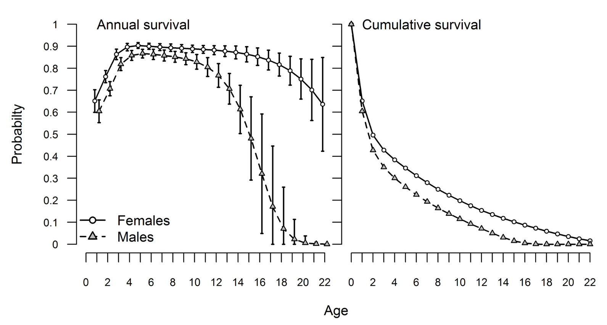
- **Survival Probability** ( $S_0, S_1, S_2, ...$ ) always between 0 and 1.

- **Cumulative Survival** ( $1, S_0, S_0 S_1, S_0 S_1 S_2, ...$ ) always starts at 1 and goes to 0

.center[([Altukhov et al. 2015](https://journals.plos.org/plosone/article?id=10.1371/journal.pone.0127292)
)]
]

.pull-right-40[

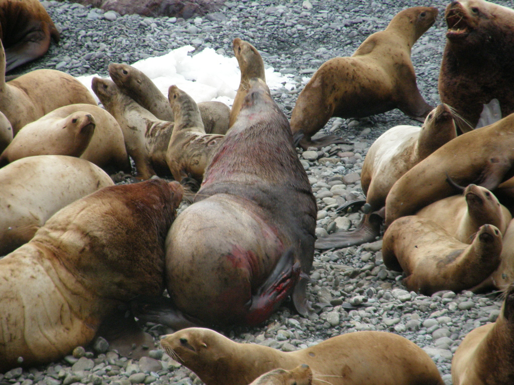
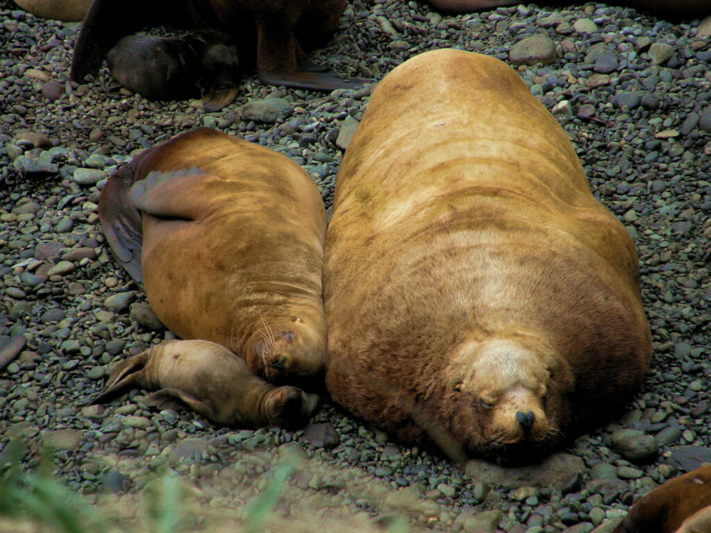

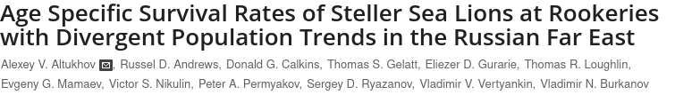


]

---

## **Basic fact of life II:** Fecundity varies with age!

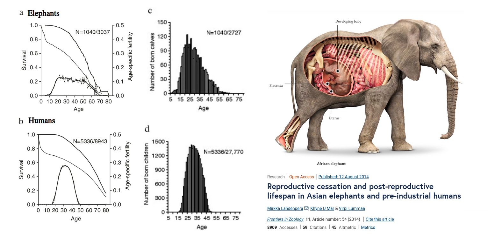
.center[([Lahdenperä et al. 2015](https://frontiersinzoology.biomedcentral.com/articles/10.1186/s12983-014-0054-0))]


---
background-image: url("images/KhanLifeHistory.png")
background-size: cover
class:white

## .white[**Life History** is the reproduction / mortality pattern]


---

## Survival curves

.pull-left-60[
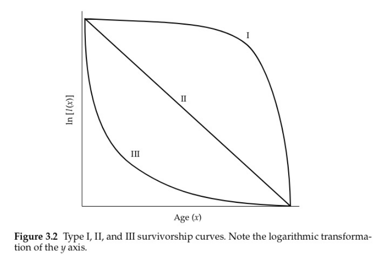
]

.pull-right-40.large[

- **TYPE I:** high survivorship for juveniles; most mortality late in life

- **TYPE II:** survivorship (or mortality) is relatively constant throughout life

- **TYPE III:** low survivorship for juveniles; survivorship high once older ages are reached
]


---

# Life history strategies: *r*-selected, vs. *K*-selected species

For a long time a popular **paradigm** (conceptual model purporting to explain a wide range of phenomenon) for understanding evolutionary drivers of life-history variation.   Still popularly taught: 

.center[
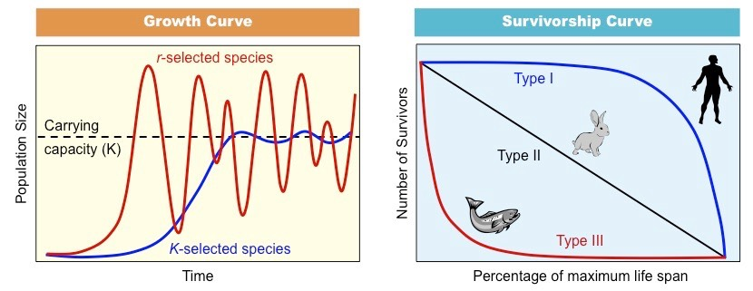
]

---
background-image: url("images/walrusoysters.png")
background-position: center
background-size: contain

.pull-left-30[
### r-selected species

#### strategy:


- lots of offspring
- little or no parental investment
- semelparous
- early maturity
- Type III survivorship 
- low survivorship
- short life-expectancy

#### drivers: 
- small size
- unstable / unpredictable environments

#### consequence
- highly fluctuating populations
]


.pull-right-30[

### K-selected species

#### strategy:

- few offspring
- lots of parental investment
- high survivorship
- late maturity
- iteroparous
- long life-expectancy
- Type I survivorship schedule

#### drivers:
- stable environments
- large

#### consequence
- more stable / slowly-fluctuating  populations

]

---

## Nice theory you've got there, but lots of counter-examples

.pull-left[
- What about **trees**?  They're big, they're long-lived (very **K**), but they produce and disperse a **heckload** of seeds (very, very **r**).
]

.pull-right[
- What about **iteroparous** species (**K**) that are hedging their bets against high inter-annual variation in environmental conditions (very **r**)? 
]

> .green[The r- and K-selection paradigm 
was  focussed on **density-dependent selection**. This paradigm 
was challenged as it became clear that ... **age-specific mortality** 
provide[s] a more mechanistic link between an environment and an 
**optimal life history** ...] ([Reznick et al. (2002) Ecology](https://esajournals.onlinelibrary.wiley.com/doi/full/10.1890/0012-9658%282002%29083%5B1509%3ARAKSRT%5D2.0.CO%3B2))


---
background-image: url("images/salmonids.png")
background-size: cover

## Salmonid (counter)-example


<br><br><br>
.center.large[

**Semelparous species**

Much bigger eggs (189 > 86 mg).

Also nest building and guarding behavior, before dying,

i.e. greater investment in **Juvenile Survival** over **Adult Survival**. 

The iteros just keep staying alive and trying to 

breed again and again. 
]
--

.pull-left.center[
> Inconsistent with **r**-**K** paradigm!
]

---

.pull-left[
### Tasmanian devil (*Sarcophilus harrisii*)

.center[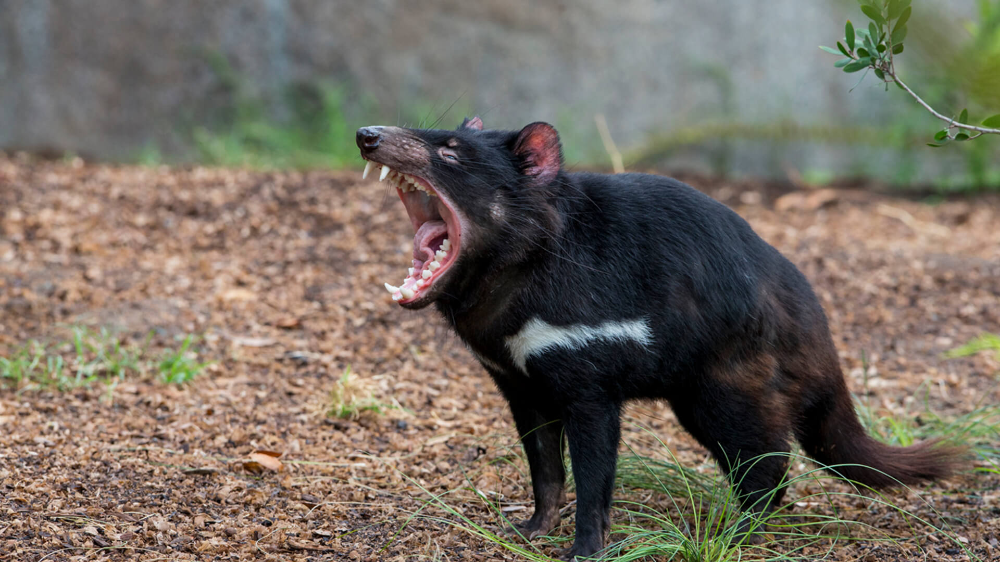]

Only marsupial carnivore | range restricted to Tasmania


.pull-left[
.darkred[Dying of *facial tumor disease*;  an infectious cancer (!) which kills nearly all adults > 3 years
]]

.pull-right[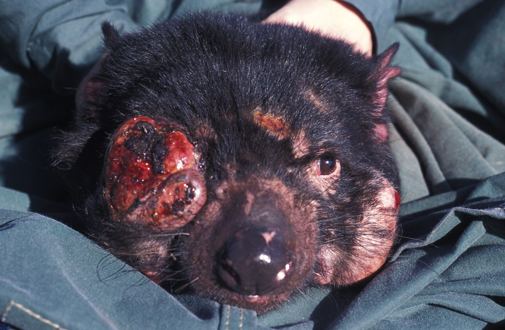]
]

--


.pull-right-40[
### Switch to Semelparity

.green[**Previously:**  Longer-lived, and iteroparous, with later birth (over 1 year old)]

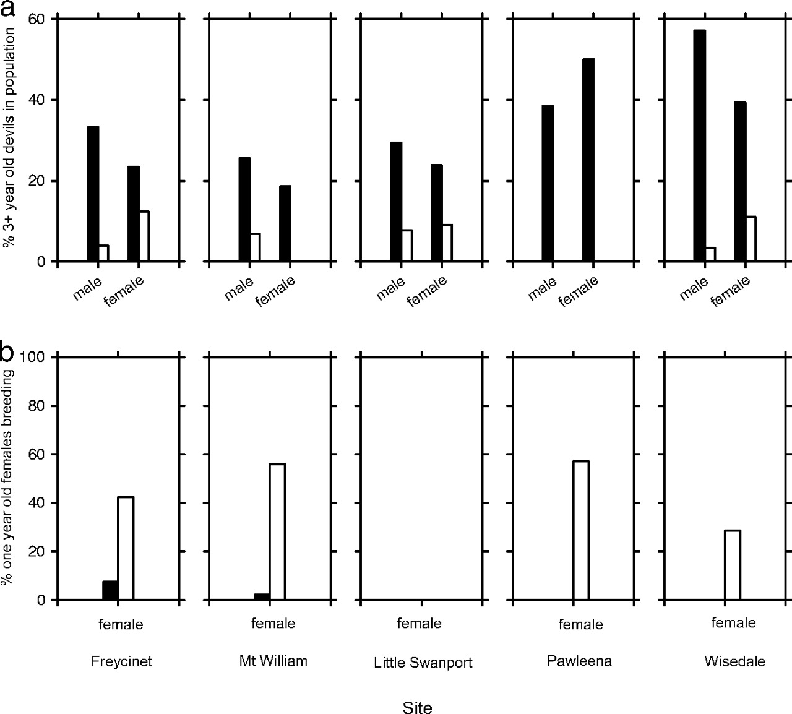

.darkblue[**Now:** Semelparous, one-shot, younger mothers (almost NO 2-3 year old animals!)] ([Jones et al. (2013)](https://doi.org/10.1073/pnas.0711236105))
]   


---

##  *Monoceros academicus*: Three Life Stages

. | Larva | Sophomore | Emeritus |
--- |:----------:|:------:|:---:|
. | 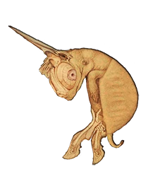 |  |  |
<font size = 5> Survival | <font size = 5> 0.5  |<font size = 5>1      | <font size = 5>0  |
<font size = 5> Fecundity |<font size = 5> 0    | <font size = 5>1.5    | <font size = 5>0.5 |
||||


> - **Survival** is a **probability** (unitless)
>
> - **Fecundity** is an **expected number** of offspring (n. ind.). 

</center>

--

**Human experiment:**  8 volunteers please. 

---


```{r}
source("functions.R")
```


.pull-left-40[
## Experiment: results

Stage | Survival | Fecundity
----------|------|---
1. larvae  | 0.5  | 0
2. sophomore | 1    | 1
3. emeritus   | 0    | .5


See numerical experiment: https://egurarie.shinyapps.io/AgeStructuredGrowth/

]

.pull-right-60[
```{r runPop1, echo = FALSE, eval = TRUE, fig.width = 6, fig.height = 4, out.width = "100%"}
pars()
require(expm)
M <- rbind(c(0,1.5,.5),
           c(.5,0,0),
           c(.0,1,0))
runPop(M)
```

]


>- Overall growth: $\huge \lambda = 1$

>- Stable age distribution: 50%, 25%, 25%


---


.pull-left-40[
## Change one value ....

Stage | Survival | Fecundity
----------|------|---
1. larvae  | 0.5  | 0
2. sophomore | 1    | <font size = 6, color = "red"> **2** </font>
3. emeritus   | 0    | .5
]


.pull-right-60[
```{r runPop2, echo = FALSE, eval = TRUE, fig.width = 6, fig.height = 4, out.width = "100%"}
pars()
require(expm)
M <- rbind(c(0,2,.5),
           c(.5,0,0),
           c(.0,1,0))

palette(rainbow(3))
runPop(M, 40)
```

>- Overall growth: $\huge \lambda = 1.11$

>- Stable distribution: 54%, 24% 22%

]

---


## *Monoceros academicus*: Type I

.pull-left[
```{r MonocerusTypeI, fig.height = 3, fig.width = 4, out.width = "100%"}
pars()

age <- 1:4
l <- c(1, .5,1,0)
S <- cumprod(l)
plot(age, S+.01, type = "o", 
     ylab = "cumulative survival", pch = 19, log = "y", xaxt = "n")
axis(1, at = 1:4, c("larva", "sophomore","emeritus","dead"))
```
]

.pull-right[

- **TYPE I:** high survivorship for juveniles; most mortality late in life.  Investment in young and survival.  Typical of long-lived species. 

Stage | Survival | Fecundity
----------|------|---
1. larvae  | 0.5  | 0
2. sophomore | 1    | 1.5
3. emeritus   | 0    | .5
]

---

.pull-left-70[

## Pink Salmon (*Onchorrhynchus gorbusha*)

.pull-left[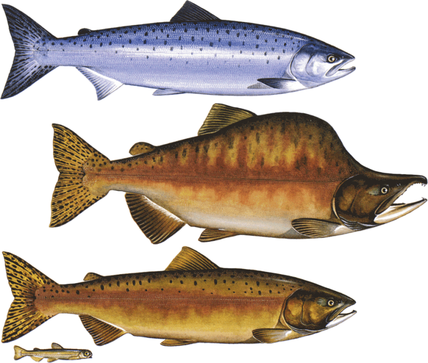]
.pull-right[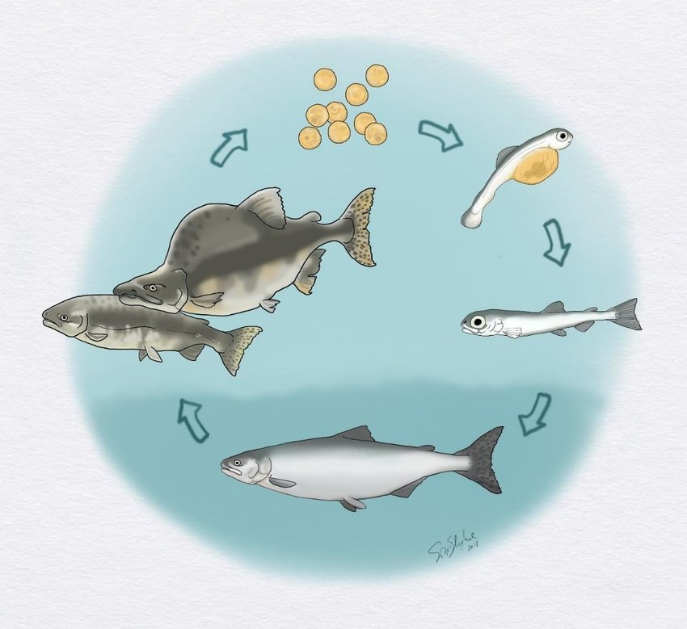]
]

.pull-right-30[
### Strict 2-year life cycle

Year 0: 
- Spawn in late-summer 
- Hatch in winter
- Emerge in spring

Year 1: 
- Ocean phase

Year 2. 
- Enter freshwater late spring
- Spawn
- Die

]

---

## Pink Salmon (*Onchorrhynchus gorbusha*): Type III

.pull-left[
```{r OnchorhynchusTypeII, fig.height = 3, fig.width = 4, out.width = "100%"}
pars()

age <- 1:4
l <- c(1, 0.02,0.5,0)
S <- cumprod(l)
plot(age, S+.01, type = "o", ylab = "cumulative survival", pch = 19, log = "y", 
     xaxt = "n")
axis(1, at = 1:4, c("smolt", "ocean","return","dead"))
```
]

.pull-right[

- **TYPE III:** low survivorship for juveniles; survivorship high once older ages are reached.  Basically - produce a whole boatload of offspring and hope for the best. Typically short-lived species. 


Stage | Survival  | Fecundity
----------|-------|---
1. smolt  | 0.05   | 0
2. ocean  | 0.9   | 0
3. return | 0     | 21
]


---

# Matrix Models


A **matrix** is a tool for **transforming vectors**.  

A **population matrix** transforms a structured population **vector** by 

1. adding newborns, [fecundity: $f_i$]
2. killing off older classes, [survival: $s_i$]
3. scootching everyone up the stage ladder [aging]

.pull-left[
$$\begin{bmatrix}
   n_0 \\
   n_1 \\
   \vdots \\
   n_{\omega - 1} \\
 \end{bmatrix}_{t+1}
=
 \begin{bmatrix}
f_0 & f_1 & f_2 & \ldots & f_{\omega  - 2} & f_{\omega  - 1} \\
s_0 & 0 & 0 & \ldots & 0 & 0\\
0 & s_1 & 0 & \ldots & 0 & 0\\
0 & 0 & s_2 & \ldots & 0 & 0\\
\vdots & \vdots & \vdots & \ddots & \vdots & \vdots\\
0 & 0 & 0 & \ldots & s_{\omega - 2}  & 0
 \end{bmatrix}
 \begin{bmatrix}
  n_0 \\ n_1 \\ \vdots\\ n_{\omega - 1}
 \end{bmatrix}_{t}$$
]

.pull-right-40[

**The Leslie Matrix**

- is square
- the rows and columns represent age classes
- the top row is the number of **births** coming in from older age classes
- the lower rows are the number of **survivors** into the next age class
]


---

## Remember *Monocerus academicus* ... 


.pull-left-60.center[

. | Larva | Sophomore | Emeritus |
--- |:----------:|:------:|:---:|
**Monoceros academicus** |  |  |  |
 Survival | 0.5  |1      | 0  |
 Fecundity | 0    | 1.5    | 0.5 |
]

.pull-right-40[

Here's the matrix:

```{r, echo = FALSE}
matA <- matrix(c(
  0, 1.5, .5,
  .5, 0, 0,
  0, 1, 0
), nrow = 3, byrow = TRUE)
matA <- round(matA, 2)
# write_matex2(matA)
```

$$
\large M = \\begin{bmatrix}0&1.5&0.5 \\\\0.5&0&0 \\\\0&1&0 \\\\\\end{bmatrix}
$$

]

---

## Leslie matrix as diagram

The population matrix maps to a diagram!  These are very useful: 


.pull-left-30[

### Matrix

$$
\Large M = \\begin{bmatrix}0&1.5&0.5 \\\\0.5&0&0 \\\\0&1&0 \\\\\\end{bmatrix}
$$
]


.pull-right-70[

### Diagram

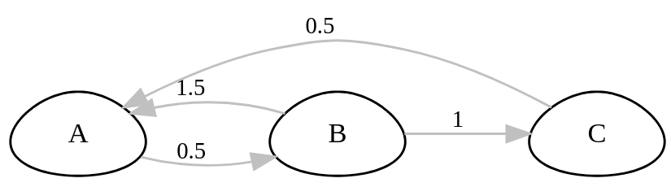

]

```{r, echo = FALSE, fig.cap=".", eval = FALSE}
par(mar = c(0,0,0,0))
mono_diagram <- Rage::plot_life_cycle(matA, stages = c("A", "B", "C"))
png("images/mono_diagram.png",width =700, height = 400, res = 200)
mono_diagram
dev.off()
```

.box-grey[
- Arrow **A** to **B** (0.5) is represented by matrix entry **column 1** to **row 2** - survival to second stage. 
- Arrow **B** to **C** (1) is matrix entry **column  2** to **row 3** - survival to last stage.
]


---

## Amazing property of population matrices ... 

<br><br>

$$\huge M \times N^* = \lambda N^*$$


.large[
For every **population matrix** there is a **stable age distribution** for which the **population matrix** increases the **distribution vector** by a fixed proportion $\lambda$.


- $\large N^*$ - is  "**eigenvector**" = .red[**stable population distribution**]

- $\large \lambda$ - is the "**eigenvalue**" = .red[**population growth factor**]
]


---

## *Monocerus academicus*

.center[]

.pull-left[

```{r, echo = TRUE}
matA <- rbind(c(0, 1.5, .5),
              c(.5, 0, 0),
              c(0, 1, 0))
```

```{r, echo = FALSE, eval = FALSE}
matA <- rbind(c(0, 1.5, .5),
              c(.5, 0, 0),
              c(0, 1, 0))
write_matex2(matA)
```

$$
\large  M = \\begin{bmatrix}0&1.5&0.5 \\\\0.5&0&0 \\\\0&1&0 \\\\\\end{bmatrix}
$$

]

.pull-right[


```{r, echo = TRUE, eval = TRUE}
eigen(matA)
```

- First eigenvalue: $\lambda = 1$
- Ratio of first eigenvector:  50% : 25% : 25%
]


---

## What if some emeriti decide to go back to school?

```{r, eval = TRUE, echo = FALSE}
matB <- rbind(c(0, 1.5, .5),
              c(.5, 0, 1/2),
              c(0, 1, 0))
```

<center>
 
</center>

.pull-left-60[
$$
\large  M = \\begin{bmatrix}0&1.5& 0.5 \\\\0.5&0&\color{red}{\textbf 0.5} \\\\0&1&0 \\\\\\end{bmatrix}
$$
]

.pull-right-40[


```{r, echo = TRUE, eval = TRUE}
eigen(matB)
```

]

<br>
<br>

.large[
- First eigenvalue: $\lambda = 1.21$

- Ratio of first eigenvector: 46% : 29% : 24% 
]


---

# Life History Tables


>.large[Widely used classic tool to obtain life-history / survivorship curves ]


A "schedule" of all births and deaths in our population
- .darkblue[**Fecundity schedule:**] *how many* offspring are born by **age**

- .darkred[**Survivorship schedule:**] *with what probability* individuals by **age**


With those (& some tedious calculations) you can compute:

- **Life expectancy**

- Population **growth rate** $\lambda$  

- **Age structure:**   .green[Are there lots of: young individuals? Old individuals? Reproductive age individuals?]

- **Survivorship patterns:** .green[Does most mortality occur in young / old / across ages?]


---
class: inverse

# Life History Tables - some "encouragement" 

.center[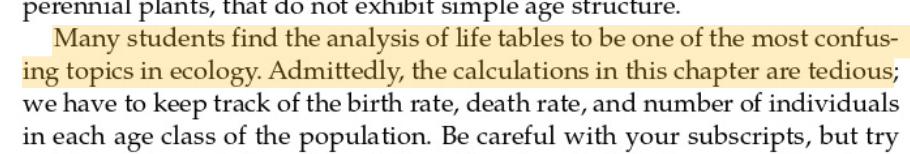]


---
.pull-left-40[## Dall's sheep

Estimated life expectance: **7.2 years** 
But it if attains 6 years of age, anover **3.4 years**
]
.pull-right-60[.center[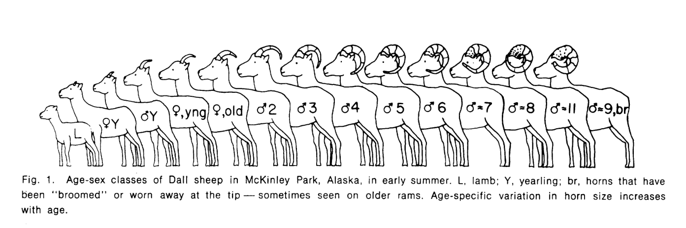]]


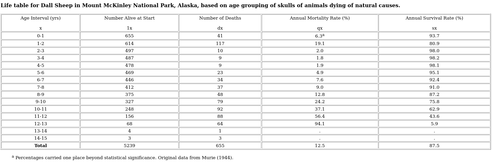
.center[(from Murie 1944)]

---

## Estimating Life Histories: **Vertical Life Table**

.large[Take a snapshot of the age distribution and build survival schedule]

.pull-left-40[

.large[
**Strong assumptions:**

- $r = 0$ or $\lambda = 1$

- processes (birth and survival schedules) are **stationary**, meaning .green[*parameters* don't change over time.]

- Of course - you also need to know **birth schedule**. 
]
]

.pull-right-60[

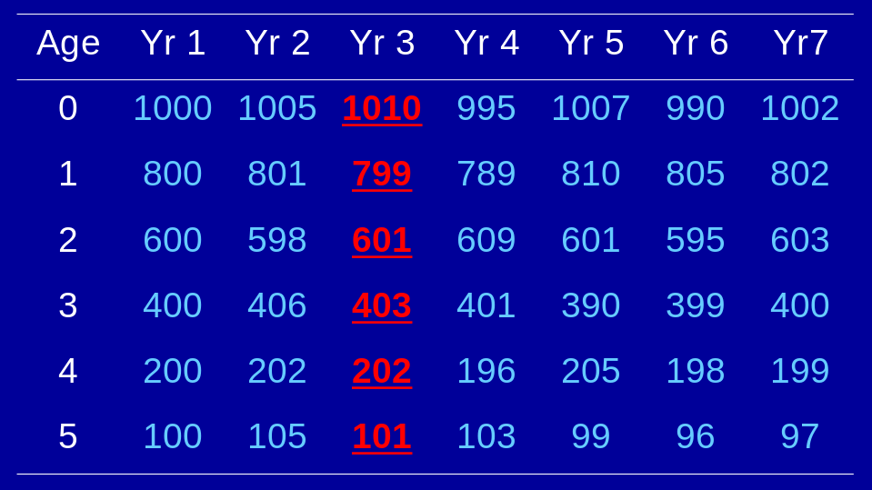
]

---

## Estimating Life Histories: **Cohort Life Table**

.large[Follow a cohort (or cohorts) through time.  Track **survival**. Track **age at birth**.] 

.pull-left-40[

.large[

**Minus:**

- Can take a really long time! 


**Plus:**

- Population always decreasing!
]]

.pull-right-60[
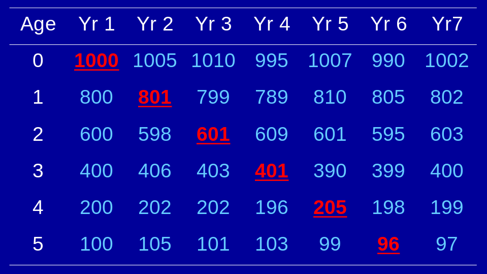
]


---

## Do these assumptions hold? 

US population pyramid - 2020

.pull-left-70.pull-right-70[
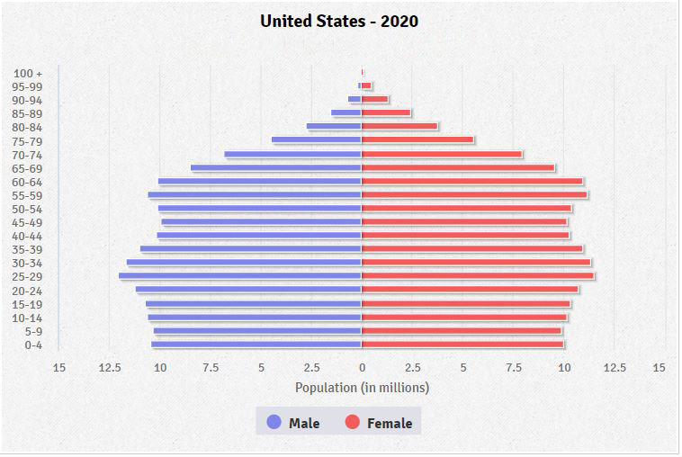
]


