class:inverse


```{r xaringan-scribble, echo=FALSE}
xaringanExtra::use_scribble()
```

```{r xaringan-tile-view, echo=FALSE}
xaringanExtra::use_tile_view()
```


# Species Interactions


## Can also limit population growth

.pull-left-40.large[

- Competition 

- Coexistence

- Predation

]

.pull-right-60[
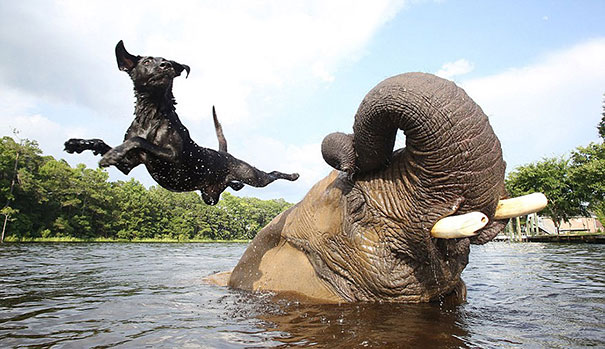]


---
class:inverse

#  Competition

.pull-left[
An interaction between organisms (intraspecific) or between species (interspecific) in which fitness of one is lowered by the presence of another.

*We've already talked about* ***intra***-*specific competition!*


### Fitness is Reproductive Success

- Combines **survival** and **reproduction**

]

.pull-right[

]

---

## Competitive Exclusion Principle

Two species **occupying the same niche** can NOT coexist

.pull-left[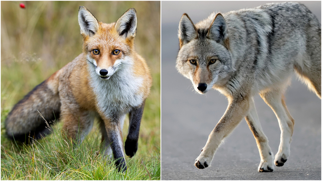

In *theory* Fox (*Vulpes vulpes*) and Coyote (*Canis latrans*) can't co-exist across southern Minnesota prairie / farmland
]


.pull-right[
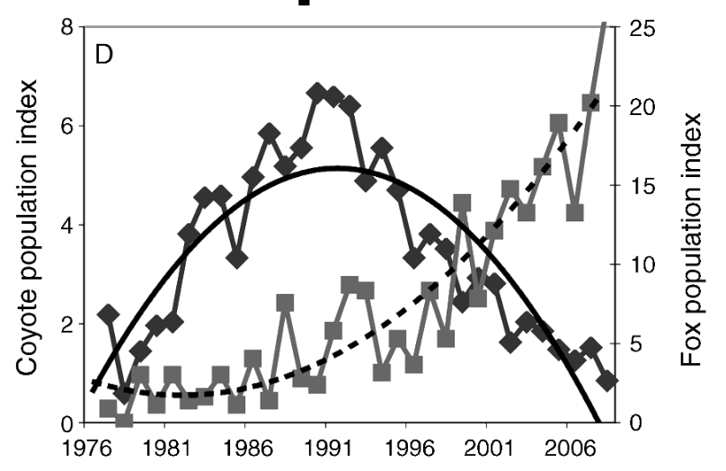

]

.center[[Levi and Wilmers (2021) *Ecology* 93(4)](https://doi.org/10.1890/11-0165.1)]


---

## Except they often do!  (via niche partitioning)

.pull-left[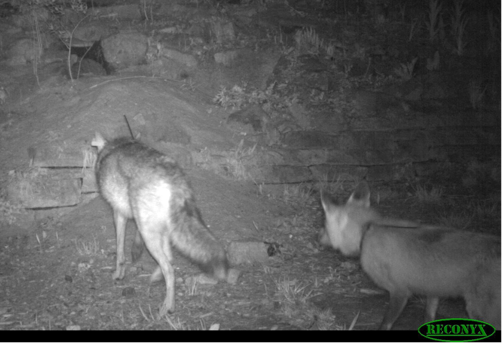


]
.pull-right-50[
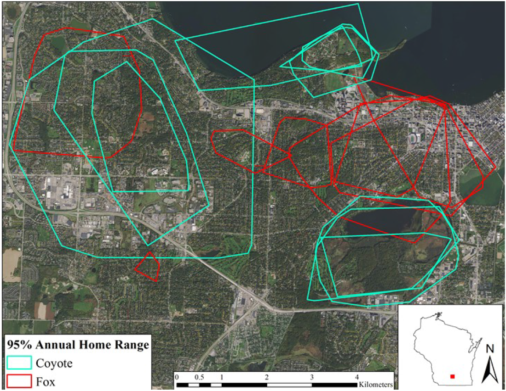

Madison, Wisconsin


]


---

## Squirlicorn vs. Pegamunk

Limited space | Limited carrying capacity |  Mutual animosity (periodic horn skewering and/or dropping on rocks) .... 

.center[***Can they get along!?***

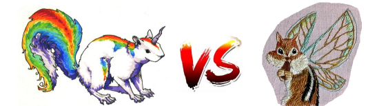

https://egurarie.shinyapps.io/SquirlicornVsPegamunk
]

--

**Takeaway:**  If the interactions are not *too* extreme relative to population growth rate, coexistence is possible. 

---

## Apparent competition 

.large[Species A eats Species B and C, if Species B increases, Species C is in trouble.]

.pull-left-60[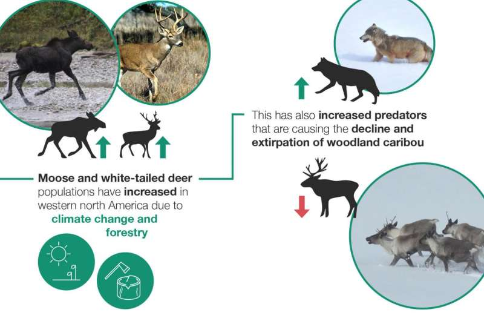]

.pull-right-40[
Major habitat fragmentation from oil-gas extraction.

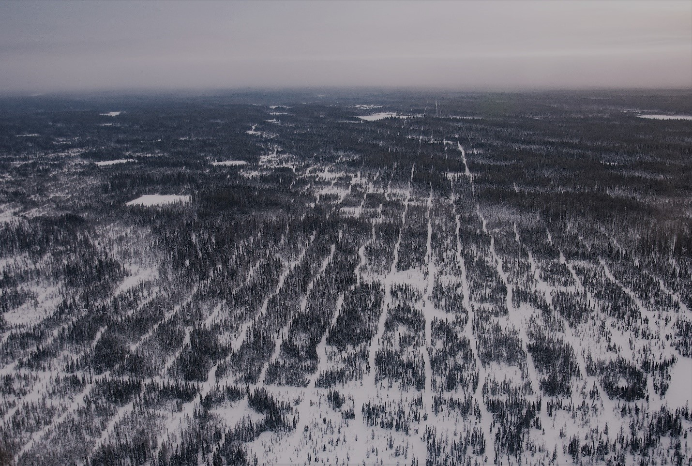
***Serrouya et al. (2017)***
]


---
class: inverse

## Predation

.pull-left[
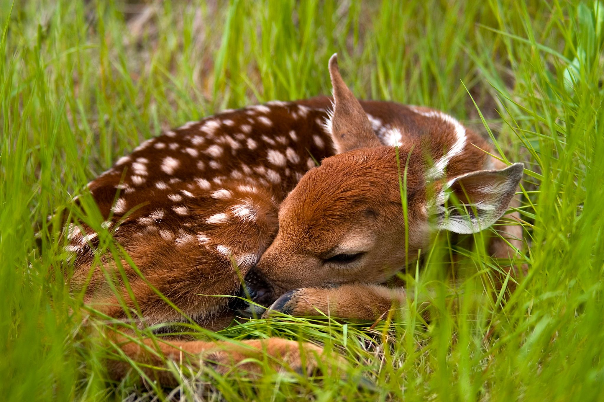
]

.pull-right.large[


an ecological process where one organism (the predator) consumes another (the prey).

- Provides most of the principle route of energy flow through ecosystems

- Strong selective pressure

- **Chief source of density dependent effects** in regulation of many animal (and plant) populations
]


---

## Predator-prey dynamics

Based (mainly) on fur sales from the Hudson Bay Company in Canada over 100 years. Roughly a 9 to 11 year, fairly synchronous, cycle.

.pull-left-60[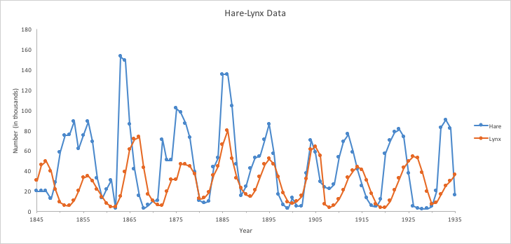]


.pull-right-40[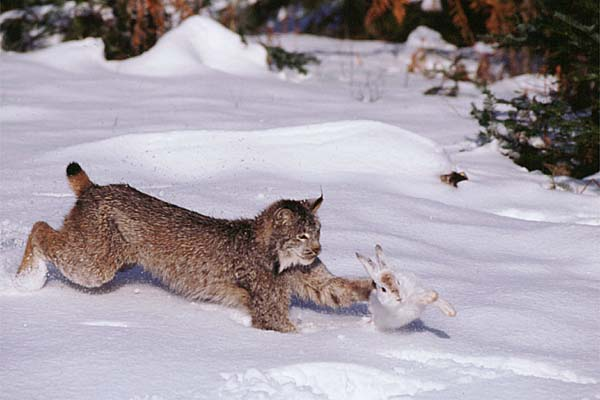]


.pull-wide[
Theory suggests the **predators** and **prey** cycle ... but it turns out that is *probably* not the case.] 


---

## Equations and models

### Exponential model

.pull-left-40[
.red[
$\large \frac{dN}{dt} = r N$
]

Basic assumption: Growth rate is proportional to population size
]

.pull-right-60[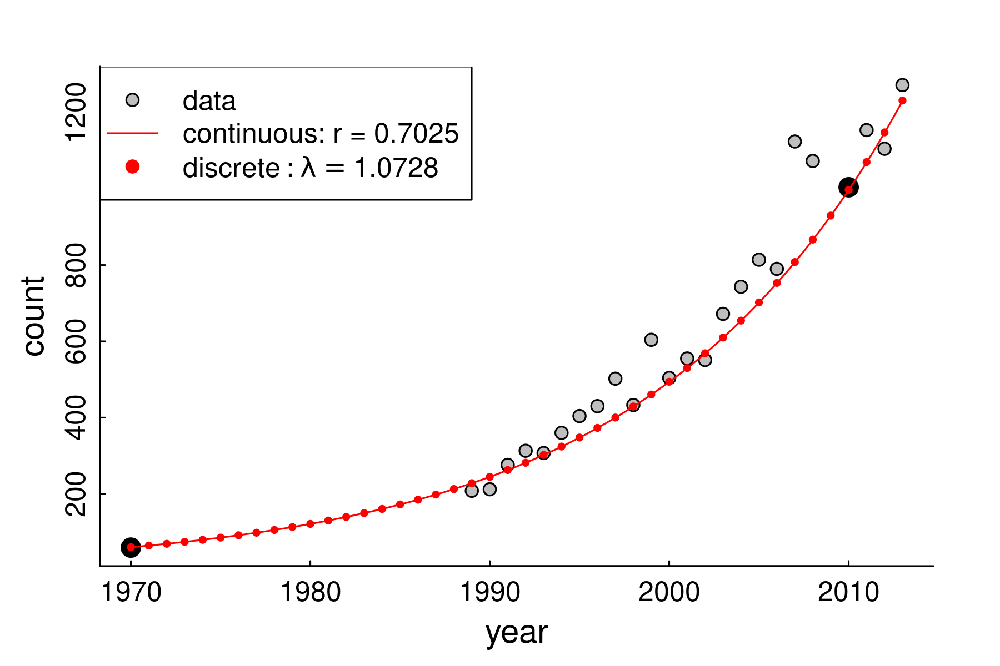]


---

## Equations and models

.pull-left[

### Exponential model

$\large \frac{dN}{dt} = r N$

.red[
### Logistic model

$\large \frac{dN}{dt} = r N \left(1 - \frac{N}{K}\right)$
]

Assumption growth rate goes to 0 at $N=K$

]

.pull-right-50[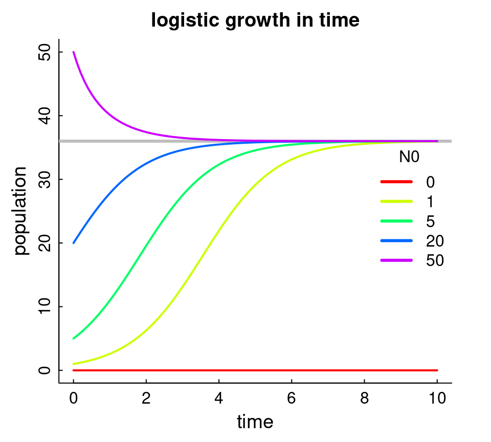]


---

## Competition model

.pull-left[

.red[
$${dC \over dt} = r_c C\left(1- {C\over K_c} - \alpha {F \over K_c}\right)$$
$${dF \over dt} = r_f F\left(1- {F \over K_f} - \beta {C \over K_f}\right)$$
]
contains carrying capacities AND interactions
]

.pull-right-50[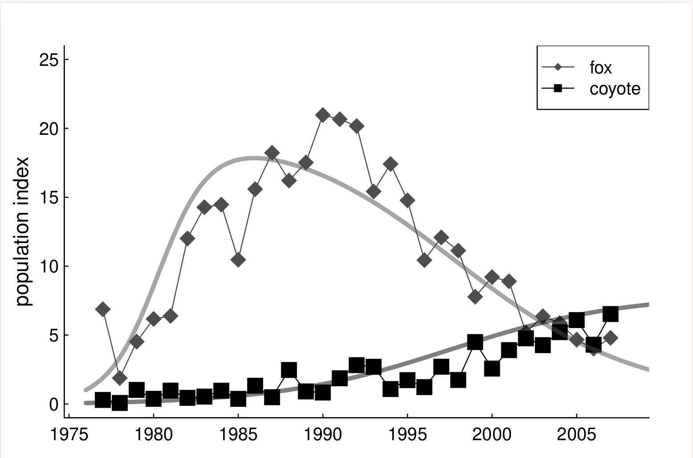]


---

## Predator-Prey Model

.pull-left-30[

.darkred[
$\large {dP \over dt}  = -q P + \gamma VP$
]
.blue[
$\large {dV \over dt}  = r V - \sigma VP$
]

]

.pull-right-70[]

---
## Predator-Prey-Prey Model

.pull-left-30[

Wolf equation $W(t)$:
$${dW \over dt} = (\gamma_m M + \gamma_c C - \delta)W $$

Moose equation $M(t)$:
$${dM \over dt} = r_m M \left(1 - {M\over K_m}\right)  - \sigma_m MW $$

Woodland caribou equation $C(t)$:
$${dC \over dt} = r_c C \left(1 - {C\over K_c} \right)- \sigma_c CW $$
]


.pull-right-60[
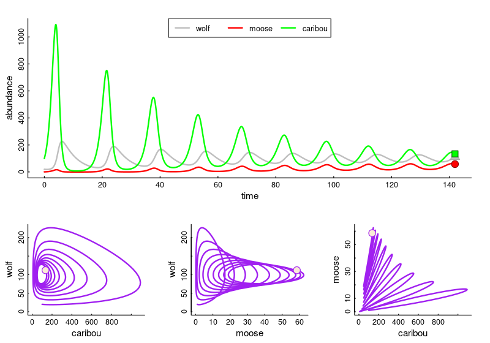
]

---


## **To learn more:** 


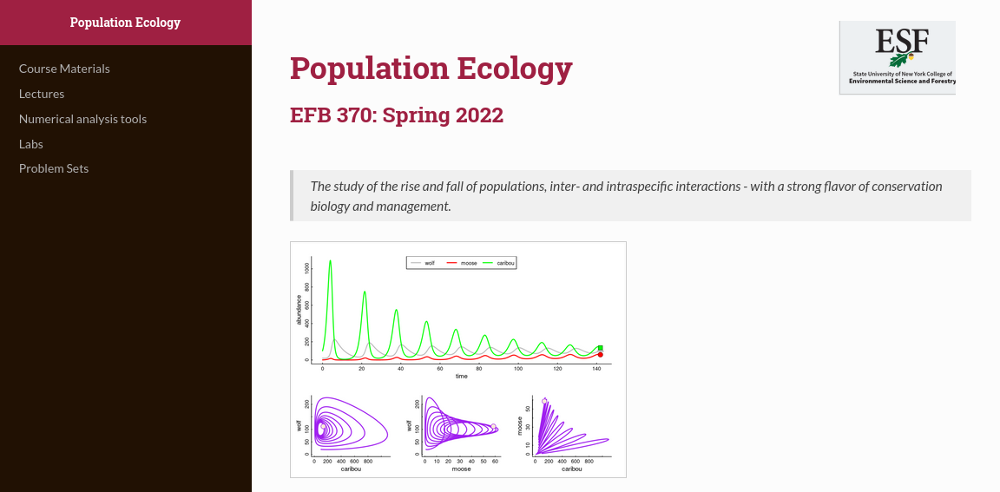

]


---

### Take-aways ....

.pull-left[
### Top-down 

Sometimes predation is extremely important at limiting growth of prey populations.

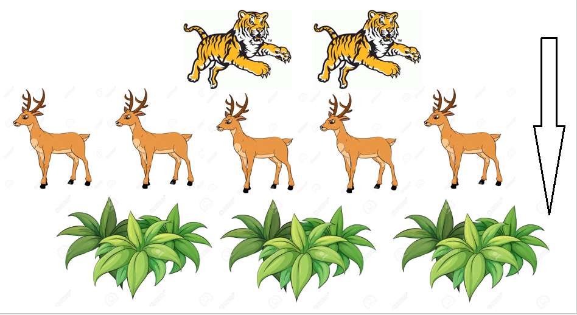
] 

.pull-right[
### Bottom-up

Sometimes, predators are very much limited by the resources coming up the chain.  

.pull-right-60[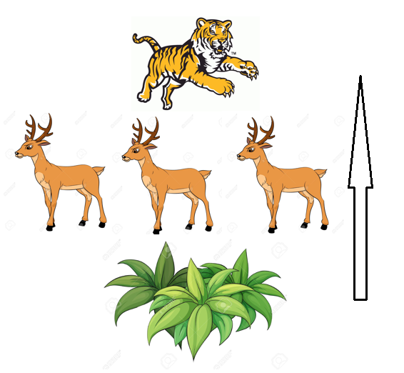]
]

.large[ Resolving these questions is hard! (and interesting), and involves a combination of deep ecological research and modeling.]